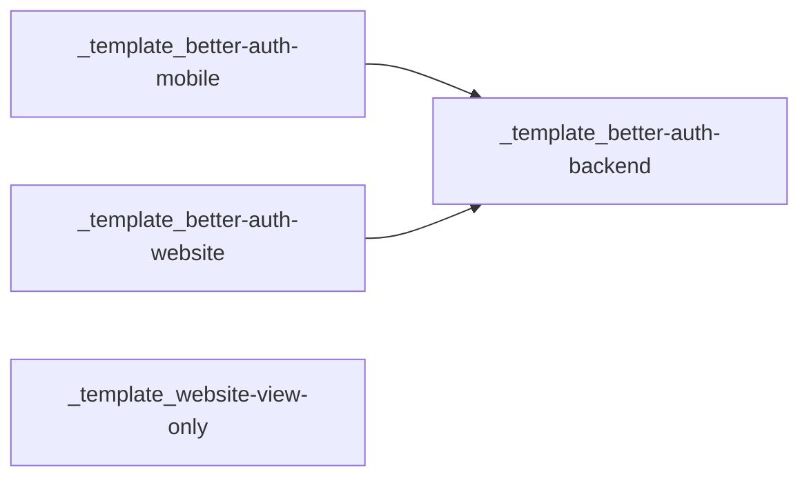

# MyVerein Backend

A Hono API for MyVerein, a club-management product for German-style Vereine (Mitgliederverwaltung, Kalender/Treffen, Lager/Material, Standort-Infocenter — see the [MyVerein Concept](../../lpj-its-vault/20_Products/MyVerein/01_Concept%20&%20Planning/Concept%20-%20MyVerein.md) in the company vault). Forked from the Better Auth Template Suite's `_template_better-auth-backend`; Better Auth still owns identity end to end (sign-up, sign-in, sessions, two-factor, organizations, admin roles) — nothing here re-implements auth.

A club is a Better Auth `organization`; a person's club identity is an app-owned `club_members` row (Wave 7, [ADR-003](../lpj-its-vault/20_Products/MyVerein/Architecture%20%26%20ADRs/ADR-003%20-%20Mitglied%20ohne%20Konto%20als%20eigene%20Entitaet.md): master data, status, category, member number, optionally linked to Better Auth's `member` account row — members without an account, e.g. children, exist too), plus a `club_roles` table for fine-grained board/department roles (Vorsitz, Kassenwart, Trainer, ...) layered on top of Better Auth's own coarse `member.role`. See [Data model](#data-model) for the full shape and [Key decisions](#key-decisions) for why the role model is split this way.

Clone it, set three environment variables, run `docker compose up`, and you have a working backend with an audit trail, rate limiting, and a real e-mail flow. The rest of this document explains what's actually in the box and why it's built the way it is.

## Table of contents

- [Getting started](#getting-started)
- [Architecture](#architecture)
- [Data model](#data-model)
- [API reference](#api-reference)
- [Adding a new API route](#adding-a-new-api-route)
- [Configuration](#configuration)
- [Security](#security)
- [Key decisions](#key-decisions)
- [Deployment](#deployment)
- [Operations](#operations)
- [Testing and CI](#testing-and-ci)
- [How this fits into the template suite](#how-this-fits-into-the-template-suite)
- [License](#license)

## Getting started

### Docker (recommended)

```
cp .env.example .env   # set BETTER_AUTH_SECRET and POSTGRES_PASSWORD at minimum
docker compose up -d
docker compose exec backend node dist/scripts/seed-admin.js
```

`npm run seed:admin` (see [Scripts](#scripts)) is the host-mode equivalent -- it isn't available inside the container itself, since the runner image ships only the compiled `dist/` output and production dependencies, not `package.json`, `src/`, or `tsx`.

The backend container runs the committed Drizzle migrations before starting the server, so tables exist after the first boot with nothing to run by hand. The admin account is a deliberately separate, explicit step — nothing is auto-provisioned from default credentials. The `db` service's port 5432 is published to the host for local inspection (psql, Drizzle Studio); remove that mapping for a deployment where only `backend` should be reachable.

### Host mode

```
npm install
cp .env.example .env   # point DATABASE_URL at a Postgres you already have running
npm run db:migrate
npm run dev
```

```
curl http://localhost:3000/health
```

### Scripts

| Script | Purpose |
|---|---|
| `npm run dev` | Hot-reloading dev server (`tsx watch`) |
| `npm run build` | Compile to `dist/` |
| `npm run start` | Run the compiled server |
| `npm run db:generate` | Generate a Drizzle migration from schema changes |
| `npm run db:migrate` | Apply migrations via the `drizzle-kit` CLI (host mode) |
| `npm run db:migrate:runtime` | Apply migrations via Drizzle's own migrator, no `drizzle-kit` dependency needed — what the Docker image runs |
| `npm run seed:admin` | Create or promote the admin user from `ADMIN_EMAIL`/`ADMIN_PASSWORD` |
| `npm run seed:club` | Bootstrap a demo club and make `ADMIN_EMAIL` its "vorsitz" — needed for local dev. Real users create clubs through the Wave 6 registration + review flow (`/club-registrations`, [Club registration](#club-registration)); `organization/create` is closed for end users, `seed:club` and the approval call `auth.api.createOrganization` server-side, which is still allowed. See `src/scripts/seed-club.ts` |
| `npm run auth:generate` | Regenerate `src/auth/auth-schema.ts` from the Better Auth config |
| `npm run lint` | ESLint |
| `npm test` | Vitest (unit + integration) |

## Architecture

Hono handles routing and middleware; Better Auth owns everything under `/api/auth/*`; Drizzle talks to Postgres. There is exactly one `betterAuth()` instance (`src/auth/auth.ts`) and exactly one Postgres pool (`src/db/client.ts`) — both are imported everywhere they're needed rather than re-created per request.

```mermaid
flowchart TD
    subgraph Clients
        Web["myverein-website\n(Next.js)"]
        Mobile["myverein-mobile\n(Expo)"]
    end

    subgraph Backend["myverein-backend"]
        CORS["CORS + secureHeaders + requestId\n(global middleware)"]
        Auth["/api/auth/*\nBetter Auth handler"]
        Members["/club-members/*\nsessionGuard + clubGuard"]
        Departments["/departments/*\nsessionGuard + clubGuard"]
        ClubInfo["/club-info/*\nsessionGuard + clubGuard"]
        Calendars["/calendars/*\nsessionGuard + clubGuard"]
        Events["/events/*, /events.ics\nsessionGuard + clubGuard"]
        Availability["/availability/*\nsessionGuard + clubGuard"]
        Meetings["/meetings/*\nsessionGuard + clubGuard"]
        Registrations["/club-registrations/*\nsession, verified e-mail"]
        AdminRegistrations["/admin/club-registrations/*\nsession + adminGuard"]
        Health["/health, /ready"]
        Stats["/internal/stats\nINTERNAL_STATS_TOKEN, no session"]
        AdminStats["/admin/activity-stats\nsession + adminGuard"]
    end

    Admin["myverein-admin\n(Next.js)"]
    Portal["fleet/portal tool\n(not an end-user client)"]
    DB[(Postgres)]

    Web --> CORS
    Mobile --> CORS
    Admin --> CORS
    CORS --> Auth
    CORS --> Members
    CORS --> Departments
    CORS --> ClubInfo
    CORS --> Calendars
    CORS --> Events
    CORS --> Availability
    CORS --> Meetings
    CORS --> Registrations
    CORS --> AdminRegistrations
    CORS --> Health
    CORS --> AdminStats
    Portal -->|bearer token| Stats
    Auth --> DB
    AdminStats --> DB
    Members --> DB
    Departments --> DB
    ClubInfo --> DB
    Calendars --> DB
    Events --> DB
    Availability --> DB
    Meetings --> DB
    Registrations --> DB
    AdminRegistrations --> DB
    Stats --> DB
    Health -.->|/ready only| DB
```



Request flow for anything under `/club-members`, `/club-applications`, `/departments`, `/club-info`, `/calendars`, `/events`, `/availability`, or `/meetings`: `requestId` middleware stamps an `X-Request-Id` and attaches a request-scoped logger, `secureHeaders` sets response headers, `cors` checks the origin against `trustedOrigins`, `rateLimit` checks a per-IP bucket, `sessionGuard` calls `auth.api.getSession()` and attaches `user`/`session`, `clubGuard` resolves which club (`organization`) the request is for and attaches `clubId`/`membership`/`clubRoleTypes` — and only then does the route handler run. `POST /club-members/apply` is the one exception: it deliberately skips `clubGuard` (the applicant isn't a member yet; `/club-applications` itself runs the full chain plus a `members:write` check), see [Key decisions](#key-decisions). `/club-registrations` (applicant, no club yet) runs `sessionGuard` plus a verified-e-mail check, `/admin/club-registrations` runs `adminGuard`; neither uses `clubGuard`, see [Club registration](#club-registration). `GET /events.ics` is mounted separately at top level (see [Layout](#architecture) below) but runs the same `sessionGuard` + `clubGuard` chain — there is no unauthenticated calendar-feed link, see [Key decisions](#key-decisions). Any error thrown at any stage becomes an `AppError` via `toAppError()` in `app.onError` — nothing unhandled ever reaches a client as a raw stack trace.

Layout:

```
src/
├── auth/             # Better Auth instance, generated schema, RBAC statements
├── db/                # Drizzle client, migrations, app-owned schema (club_members, member_categories, club_member_departments,
│                       #   club_member_status_history, club_settings, club_exit_requests, club_memberships [deprecated, read-only], departments,
│                       #   club_roles, guardian_links, club_info_pages, club_applications, audit_log, calendars,
│                       #   calendar_visibility, events, event_attendees, availability_slots,
│                       #   availability_exceptions, meetings, meeting_invitees, meeting_attendance,
│                       #   meeting_resolutions, club_registrations, club_registration_documents)
├── lib/               # errors, email, logger, activity-stats, club-permissions, calendar-visibility,
│                       #   availability-match, ics, member-number, club-members, club-slug, club-registrations, club-registration-mail — cross-cutting, no HTTP awareness
├── middleware/         # session-guard, club-guard, rate-limit, request-id
├── routes/            # health, club-members, club-applications, club-registrations, admin-club-registrations, departments, club-info, calendars, events, availability,
│                       #   meetings, internal-stats, admin-stats, admin-clubs
└── scripts/           # seed-admin, seed-club (CLI, not server runtime)
```

## Data model

Better Auth manages its own tables (generated into `src/auth/auth-schema.ts` by `npm run auth:generate` — do not hand-edit that file), including `organization`/`member`/`invitation` from the `organization()` plugin, which MyVerein uses as its club/membership fundament (a club **is** an `organization`). The app owns thirty-five more: the Wave 1 set — `club_memberships` (deprecated since Wave 7, no longer written), `club_applications` (Wave 5), `departments`, `club_roles`, `guardian_links`, `club_info_pages`, `audit_log`, and `notification`/`notification_state`/`notification_template` (unchanged from the suite) — the Wave 2 calendar/meeting set — `calendars`, `calendar_visibility`, `events`, `event_attendees`, `availability_slots`, `availability_exceptions`, `meetings`, `meeting_invitees`, `meeting_attendance`, `meeting_resolutions` — and the Wave 3 location/inventory set — `locations`, `location_key_holders`, `location_wifi_networks`, `location_links`, `inventory_items`, `inventory_loans`, `inventory_damage_reports` — and the Wave 6 club-registration set — `club_registrations`, `club_registration_documents` — and the Wave 7 member-foundation set — `club_members`, `member_categories`, `club_member_departments`, `club_member_status_history`, `club_settings`, `club_exit_requests`. See the company vault's [Data Model - MyVerein Backend](../../lpj-its-vault/30_Engineering%20&%20Tech/System%20Design/MyVerein/Data%20Model%20-%20MyVerein%20Backend.md) for the full planning doc.

```mermaid
erDiagram
    user ||--o{ session : "has"
    user ||--o{ account : "has"
    user ||--o{ member : "belongs to clubs via"
    user ||--o{ two_factor : "has"
    organization ||--o{ member : "has"
    organization ||--o{ invitation : "has"
    organization ||--o{ departments : "has"
    organization ||--o{ club_info_pages : "has"
    user ||--o{ club_applications : "applies via"
    organization ||--o{ club_applications : "receives"
    member ||--o{ club_applications : "decides (decided_by)"
    user ||--o{ club_registrations : "applies for a new club"
    user ||--o{ club_registrations : "reviews (reviewed_by)"
    organization ||--o| club_registrations : "created by (club_id)"
    club_registrations ||--o{ club_registration_documents : "proof"
    member ||--o| club_memberships : "extends (deprecated, read-only)"
    organization ||--o{ club_members : "has"
    member ||--o| club_members : "account of (member_id, nullable, unique)"
    organization ||--o{ member_categories : "defines"
    member_categories ||--o{ club_members : "categorises"
    club_members ||--o{ club_member_departments : "belongs to"
    departments ||--o{ club_member_departments : "has"
    club_members ||--o{ club_member_status_history : "logs"
    club_members ||--o{ club_exit_requests : "leaves via"
    organization ||--o| club_settings : "configures"
    club_members ||--o{ guardian_links : "is guarded (as ward)"
    member ||--o{ club_roles : "has"
    member ||--o{ guardian_links : "guards (as guardian)"
    departments ||--o{ club_roles : "scopes (optional)"
    organization ||--o{ calendars : "has"
    departments ||--o{ calendars : "scopes (optional)"
    calendars ||--o{ calendar_visibility : "has"
    calendars ||--o{ events : "has"
    events ||--o{ event_attendees : "has"
    member ||--o{ availability_slots : "has"
    member ||--o{ availability_exceptions : "has"
    organization ||--o{ meetings : "has"
    meetings ||--o{ meeting_invitees : "has"
    meetings ||--o{ meeting_attendance : "has"
    meetings ||--o{ meeting_resolutions : "has"
    organization ||--o{ locations : "has"
    locations ||--o{ location_key_holders : "has"
    locations ||--o{ location_wifi_networks : "has"
    locations ||--o{ location_links : "has"
    locations ||--o{ events : "hosts (optional)"
    locations ||--o{ meetings : "hosts (optional)"
    organization ||--o{ inventory_items : "has"
    locations ||--o{ inventory_items : "stores"
    inventory_items ||--o{ inventory_loans : "has"
    inventory_items ||--o{ inventory_damage_reports : "has"

    user {
        text id PK
        text email UK
        boolean email_verified
        text role
        boolean two_factor_enabled
    }
    organization {
        text id PK
        text slug UK
        text name
    }
    member {
        text id PK
        text organization_id FK
        text user_id FK
        text role "Better Auth org role: owner | member, coarse"
    }
    club_memberships {
        uuid id PK
        text member_id FK "1:1"
        text member_number
        text category "aktiv | passiv | foerdernd | ehrenmitglied | jugend"
        date joined_at
        date left_at
        date birth_date
        text emergency_contact_name
        text emergency_contact_phone
    }
    club_members {
        uuid id PK "canonical member id in the API"
        text club_id FK
        text member_id FK "Better Auth member, NULL = no account, unique, ON DELETE SET NULL"
        text display_name
        text first_name
        text last_name
        date birth_date
        text street
        text postal_code
        text city
        text phone
        text contact_email
        text emergency_contact_name
        text emergency_contact_phone
        text member_number "per club unique via API (409), not in DB"
        uuid category_id FK
        text status "interessent | probe | aktiv | ruhend | ausgetreten | ausgeschlossen | verstorben"
        date joined_at
        date left_at
        text exit_reason
        timestamptz created_at
        timestamptz updated_at
    }
    member_categories {
        uuid id PK
        text club_id FK
        text key "UK with club_id"
        text name
        boolean voting_right
        int min_age
        int max_age
        text auto_transition_to_key
        int sort_order
        timestamptz archived_at
    }
    club_member_departments {
        uuid id PK
        uuid club_member_id FK
        uuid department_id FK
        date since
        date until "NULL = open, one open row per pair"
    }
    club_member_status_history {
        uuid id PK
        uuid club_member_id FK
        text from_status
        text to_status
        uuid from_category_id FK
        uuid to_category_id FK
        date effective_on
        text reason
        text changed_by FK "member.id"
    }
    club_settings {
        text club_id PK
        int notice_period_days
        text notice_mode "month_end | quarter_end | year_end | immediate"
        text member_number_prefix
        boolean allow_self_loans
    }
    club_exit_requests {
        uuid id PK
        uuid club_member_id FK
        text kind "cancellation | exclusion"
        text requested_by FK "member.id"
        date requested_on
        date desired_effective_on
        date effective_on
        text reason
        text status "pending | approved | rejected | withdrawn"
        text decided_by FK "member.id"
        timestamptz decided_at
        text decision_note
    }
    club_applications {
        uuid id PK
        text user_id FK
        text club_id FK
        text category
        date birth_date
        text status "pending | approved | rejected"
        timestamptz created_at
        timestamptz decided_at
        text decided_by FK "member.id"
    }
    club_registrations {
        uuid id PK
        text user_id FK "applicant"
        text club_name
        text legal_form "e_v | nicht_eingetragen | sonstige"
        text register_court
        text register_number
        text street
        text postal_code
        text city
        text website_url
        text claimed_role "vorsitz | stellv_vorsitz | schriftfuehrer"
        text status "draft | pending | needs_info | approved | rejected"
        text review_note
        text reviewed_by FK "user.id"
        timestamptz reviewed_at
        text club_id FK "organization, set on approval"
        text slug_suggestion
        timestamptz created_at
        timestamptz updated_at
        timestamptz submitted_at
    }
    club_registration_documents {
        uuid id PK
        uuid registration_id FK
        text kind "registerauszug | satzung | freistellungsbescheid | gruendungsprotokoll | sonstiges"
        text storage_key "registrations/<id>/..."
        text filename
        text mime_type
        bigint size_bytes
        timestamptz created_at
    }
    departments {
        uuid id PK
        text club_id FK
        text name
        text lead_member_id FK
    }
    club_roles {
        uuid id PK
        text member_id FK
        text role_type "vorsitz | kassenwart | trainer | ... see club-permissions.ts"
        uuid department_id FK "only for department-bound roles"
        date term_ends_at
    }
    guardian_links {
        uuid id PK
        text guardian_member_id FK "member.id (account required)"
        uuid ward_club_member_id FK "club_members.id (account optional)"
    }
    club_info_pages {
        uuid id PK
        text club_id FK
        text slug "satzung | leitbild | geschichte | ..."
        text title
        text content_markdown
        text external_url
    }
    audit_log {
        uuid id PK
        text event_type
        text subject_id
        jsonb payload
    }
    calendars {
        uuid id PK
        text club_id FK
        uuid department_id FK "null = club-wide"
        text name
        boolean is_default
    }
    calendar_visibility {
        uuid id PK
        uuid calendar_id FK
        text member_id FK "exactly one of member/role/department set"
        text role_type
        uuid department_id FK
    }
    events {
        uuid id PK
        uuid calendar_id FK
        text title
        timestamp starts_at
        integer capacity
    }
    event_attendees {
        uuid id PK
        uuid event_id FK
        text member_id FK
        text status "angemeldet | abgesagt | warteliste"
    }
    availability_slots {
        uuid id PK
        text member_id FK
        integer weekday "0-6, Monday-Sunday"
        time start_time
        time end_time
    }
    availability_exceptions {
        uuid id PK
        text member_id FK
        date date
        boolean is_available
    }
    meetings {
        uuid id PK
        text club_id FK
        text type
        timestamp scheduled_at "null while Terminfindung"
        text status
    }
    meeting_invitees {
        uuid id PK
        uuid meeting_id FK
        text member_id FK
        text response "ausstehend | zugesagt | abgesagt"
    }
    meeting_attendance {
        uuid id PK
        uuid meeting_id FK
        text member_id FK
        boolean present
        boolean has_voting_right
    }
    meeting_resolutions {
        uuid id PK
        uuid meeting_id FK
        text description
        text result "angenommen | abgelehnt"
    }
    locations {
        uuid id PK
        text club_id FK
        text name
        text address
        numeric latitude
        numeric longitude
        text photo_url
    }
    location_key_holders {
        uuid id PK
        uuid location_id FK
        text member_id FK
    }
    location_wifi_networks {
        uuid id PK
        uuid location_id FK
        text ssid
        text password "plain text, see Security"
        boolean visible_to_guests
    }
    location_links {
        uuid id PK
        uuid location_id FK
        text title
        text url
        boolean visible_to_guests
    }
    inventory_items {
        uuid id PK
        text club_id FK
        text name
        text condition "gut | beschaedigt | defekt"
        uuid location_id FK "nullable, ON DELETE SET NULL"
        integer acquisition_value_cents
        integer maintenance_interval_days
        date last_maintenance_at
    }
    inventory_loans {
        uuid id PK
        uuid item_id FK
        text member_id FK
        timestamp due_at
        timestamp returned_at
        text status "ausgeliehen | zurueckgegeben (ueberfaellig is derived, never stored)"
    }
    inventory_damage_reports {
        uuid id PK
        uuid item_id FK
        text reported_by FK
        text description
        text photo_url "media storage key, not a public URL"
        text status "gemeldet | in_bearbeitung | behoben"
    }
```



`notification`/`notification_state`/`notification_template` are omitted from the diagram above for space — unchanged from [Data Model - Better Auth Backend](../../lpj-its-vault/30_Engineering%20&%20Tech/System%20Design/Better%20Auth%20Template%20Suite/Data%20Model%20-%20Better%20Auth%20Backend.md), see there for the full shape.

**Two role concepts, deliberately layered, not merged.** Better Auth's `member.role` is the org plugin's own coarse role (`owner`/`member` by default, unmodified) and only matters for Better-Auth-native organization actions. Everything MyVerein-specific — who can edit member data, assign roles, manage departments or club info — is decided by `club_roles.role_type` via `src/lib/club-permissions.ts`'s `hasClubPermission()`, independent of `member.role`. A membership can hold several `club_roles` rows at once (e.g. `kassenwart` + `trainer`), but never the same role twice for the same department (unique constraint). See [Key decisions](#key-decisions).

**`club_members` (Wave 7, ADR-003) is the club-side identity of a person** and replaces `club_memberships` as the home of master data. `member_id` (nullable, unique, `ON DELETE SET NULL`) links the Better Auth `member` account membership; `NULL` means "member without account" (e.g. a child). Everything that needs a login stays on `member.id` (`club_roles`, loans, RSVP, availability, `departments.lead_member_id`, `club_applications.decided_by`); `guardian_links.ward_club_member_id` points to `club_members.id` while `guardian_member_id` stays an account `member.id`. **Invariant: every `member` row has exactly one `club_members` row** — created by the Better Auth `afterAddMember`/`afterAcceptInvitation` hook (`src/auth/auth.ts`), and additionally by every explicit join path through `ensureClubMember` (`src/lib/club-members.ts`: application approval, club-registration approval, `seed:club`, `/me`, `GET /club-members`). `last_user_id` remembers the account that was linked last. **Removing the account membership** (Better Auth `removeMember`, `leave`, or deleting the user) keeps the `club_members` row (`member_id` → NULL) and closes it: status `ausgetreten`, `left_at` = today, `exit_reason` "Konto-Mitgliedschaft entfernt", a `club_member_status_history` entry — so no ghost active member remains. `afterRemoveMember` does this immediately; `leave` and user deletion fire no Better Auth hook, there the same closing happens lazily on `GET /club-members` and when a member is resolved by id (`markDetachedMembersLeft`). **Re-join** of the same person (`ensureClubMember` matches `last_user_id` in the club; blocked with `409` if that row is `ausgeschlossen`/`verstorben`, see [Member lifecycle](#member-lifecycle)) reuses the old row — same member number, status back to `aktiv`, new history entry "Konto-Mitgliedschaft wiederhergestellt" — instead of creating a duplicate. Members created by the board without account (`last_user_id` NULL) are never closed by this. **Open consequence (Wave 10):** the master data of a deleted account stays in `club_members` until the data-protection concept (deletion/anonymisation) is implemented. **Operations check:** `checkClubMemberConsistency(db, clubId?)` (`src/lib/club-members.ts`) returns per club `members`, `linked`, `missing`; `missing` must be 0 (every `member` row has its `club_members` row) — run it after deployments/imports; `GET /club-members` and id resolution repair gaps on their own. `member_number` is intentionally **not** unique in the database (legacy data may contain duplicates); the API enforces uniqueness per club with `409` on manual assignment. `member_categories` holds the per-club categories (the five defaults `aktiv`, `passiv`, `foerdernd`, `ehrenmitglied`, `jugend` are created per club by `ensureDefaultCategories`; voting right: `jugend` and `foerdernd` false); `club_member_departments` links members to departments with a validity period (`until IS NULL` = current; unique per open pair); `club_member_status_history` logs status/category changes (`POST /club-members` writes the first entry, `POST /club-members/:id/transition`, category moves, age transitions and account removal add more; see [Member lifecycle](#member-lifecycle)); `club_settings` (notice period/mode, member-number prefix, `allow_self_loans`) and `club_exit_requests` (cancellation/exclusion) are schema only so far — their routes come with Wave 7 B6/B8. Migration `0017_member-search-index` adds `club_members_club_name_idx (club_id, lower(display_name))` for the paged name sort (B9; together with `(club_id, status)` and `(club_id, member_number)`; number 0016 is reserved for the parallel rights work). Migrations `0014_member-foundation` and `0015_member-lifecycle` (adds `last_user_id`, backfills it, folds umlaut legacy categories such as `Fördernd` into the default key `foerdernd`, warns about guardian links across club borders — they are kept) create the tables, **backfills** idempotently (default categories per club + unknown legacy categories as extra categories; one `club_members` row per `member` row with master data from `club_memberships` — status `ausgetreten` if `left_at <= today`, else `aktiv`; `joined_at` falls back to `member.created_at`; `display_name`/`contact_email` from the user), aborts with `club_members backfill count mismatch` if rows ≠ members (count check), moves `guardian_links` to `ward_club_member_id` (old `ward_member_id` dropped) and leaves `club_memberships` untouched as a read-only legacy table. The migrations run in one transaction (a failure leaves nothing half-migrated). They are tested against scratch databases migrated to Wave 6 state (`src/db/migration-member-foundation.test.ts`, `src/db/migration-member-edgecases.test.ts`: duplicate numbers, umlaut categories, empty slug, cross-club guardian link, re-run of the migrator, atomic rollback).

`club_memberships` (deprecated, no longer written) was a 1:1 sidecar on Better Auth's `member` row (not on `organization` — MyHome's `household_profiles` uses the org-level version of this pattern, this is the same idea one level down), the same way you'd extend a library-owned table you can't otherwise touch.

`club_applications` is the pending-approval queue behind `POST /club-members/apply`: `id`, `user_id` (FK `user`, cascade), `club_id` (FK `organization`, cascade), `category` (default `aktiv`), `birth_date` (nullable), `status` (`pending` | `rejected` | `approved`, free text validated in routes, default `pending`), `created_at`, `decided_at` (nullable), `decided_by` (nullable FK `member.id`, `ON DELETE SET NULL`). A partial unique index on `(user_id, club_id) WHERE status = 'pending'` allows only one open application per user and club. Migration `0012_club-applications`.

`club_registrations` holds the Wave 6 "Verein gründen" applications (see [Club registration](#club-registration)): `user_id` (applicant, FK `user`, cascade), the club data (`club_name`, `legal_form`, `register_court`/`register_number` — required for `e_v` —, `street`/`postal_code`/`city`, `website_url`), `claimed_role`, `status` (`draft` | `pending` | `needs_info` | `approved` | `rejected`, free text validated in the routes), `review_note`, `reviewed_by` (FK `user`, `SET NULL`), `reviewed_at`, `club_id` (FK `organization`, `SET NULL`, set on approval), `slug_suggestion`, `created_at`/`updated_at`/`submitted_at`. A partial unique index on `(user_id) WHERE status IN ('draft','pending','needs_info')` allows only one open registration per user. `club_registration_documents` stores the proof files: `registration_id` (FK, cascade), `kind`, `storage_key` (private path `registrations/<registration id>/<uuid>-<sanitized filename>`, never exposed), `filename`, `mime_type`, `size_bytes`. Migration `0013_club-registrations`.

<a id="member-numbers"></a>**Member numbers.** `club_members.member_number` is generated automatically in the format `<ABBR>-<NNNN>`: `ABBR` is the first 4 alphanumeric characters of the club slug, uppercased (`demo-sportverein` → `DEMO`, fallback `CLUB`), `NNNN` is the larger of the club's `club_members` row count (members without account included) and the highest numeric suffix already issued for that prefix, plus one, zero-padded to 4 digits (`DEMO-0001`). Implemented in `src/lib/member-number.ts` (`clubAbbreviation`, `nextMemberNumber`), which locks the club's `organization` row (`SELECT … FOR UPDATE`) inside the creating transaction so concurrent creations get distinct numbers. It is applied whenever a `club_members` row is created (`ensureClubMember`: every join path; `POST /club-members` unless `memberNumber` is sent); the board can overwrite it via `PATCH /club-members/:id` — a manually set number that is already used by another member of the club answers `409`. Deleted members therefore no longer cause a repeat, but a manually assigned number in a different format can still equal a later generated one — the column has no unique constraint in the DB (legacy duplicates), uniqueness is enforced by the API on manual writes only.

`guardian_links` is the scoping boundary for the externe Rolle (Erziehungsberechtigte, see the Concept doc's persona of the same name): a many-to-many table linking a guardian account membership (`guardian_member_id` = `member.id`) to the youth club member(s) (`ward_club_member_id` = `club_members.id`, may have no account) they're responsible for. Any route exposing per-member data to a `guest`-tier caller must check this table before returning anything about a member who isn't the caller's own row.

`audit_log` is written inside the same Postgres transaction as the domain mutation that triggered it (see `src/routes/club-members.ts`) and via a Better Auth `databaseHooks.session.create` hook (see `src/auth/auth.ts`) — session creation and every membership/role/department/info-page mutation leave a row. This only works because auth and domain data share one database.

`notification`/`notification_state` use a lazy-state model: no `notification_state` row for a given `(notification_id, user_id)` pair means "unread, not deleted" for that user — read/unread/delete only ever upsert one row (unique index on that pair) instead of pre-seeding a row per recipient on every broadcast. A `system` notification (e.g. the post-signup welcome, written by the `databaseHooks.user.create` hook in `src/auth/auth.ts`) carries `translation_key`/`params_json` so every client renders it in the viewer's own language; an `admin` notification (created via `/admin/notifications`) is pre-translated into a `translations` JSONB blob instead (`Record<langCode, {title, body}>`, keyed by the shared `SUPPORTED_LANGUAGES` registry used by the website/mobile `t()` contexts — see [[ADR-009]]), since there is no machine translation here.

`notification_template` lets an admin override a `system` notification's built-in translation-key text (see `/admin/notification-templates` below) — one row per known `translation_key` (the registry lives in `src/routes/admin-notification-templates.ts`'s `NOTIFICATION_TEMPLATE_KEYS`), holding a `translations` JSONB blob (`de`/`en` required, any other supported language optional) instead of a key clients resolve themselves. The `databaseHooks.user.create` hook looks this table up when it writes the welcome notification and bakes the override's `translations` into that row if one exists — so editing a template only affects *future* notifications of that kind, same as any other already-created row never retroactively changing. No override yet (the common case) means `translations` stays `null` and clients fall back to their local `translation_key` text, so this is not a breaking change. This table previously held fixed `title_de`/`title_en`/`body_de`/`body_en` columns — a JSONB blob replaced them so a new language is a registry entry, not a schema migration (see `src/db/migrations/0003_add-notification-translations-jsonb.sql` through `0005_drop-notification-legacy-de-en-columns.sql`).

**`calendar_visibility` is a zero-rows-default allow list**, computed by `src/lib/calendar-visibility.ts`'s `isCalendarVisible()`/`getVisibleCalendarIds()`, shared by `calendars.ts` (visibility config) and `events.ts` (event filtering). A calendar with no `calendar_visibility` rows at all is club-wide visible — no explicit "everyone" row needed. Once at least one row exists, a caller needs a matching grant: their own `memberId`, a `roleType` they hold via `club_roles`, or a `departmentId` they're scoped to via a department-bound `club_roles` row (abteilungsleitung/trainer). That department check is the one documented limitation of the model: there is no generic department-membership table in this repo, so a rank-and-file department member with no department-scoped `club_roles` row can never match a department grant, only the member/role rules. A caller holding `calendars:write` bypasses the algorithm entirely (inside `isCalendarVisible`/`getVisibleCalendarIds`, so for calendars, events and the iCal feed alike) — board oversight, they need to see and manage calendars they restricted to others.

**RSVP capacity and waitlisting are enforced under a row lock, not just an application-level count.** `POST /events/:id/rsvp` and `DELETE /events/:id/rsvp` both open with `SELECT ... FOR UPDATE` on the event row before counting confirmed attendees. That lock was added after review: under Postgres's default READ COMMITTED isolation, two concurrent RSVPs at `capacity - 1` both read "count < capacity" before either commits, and both get seated — an overbooked event with no error anywhere. The lock serializes the two requests instead, so the second one re-reads the up-to-date count once the first has committed and released it. The same lock guards waitlist promotion on cancel, for the mirrored reason: without it, two concurrent cancellations can both pick the same waitlisted row as "next in line," leaving a freed slot unfilled even though two members were waiting.

**Terminfindung (`GET /availability/overlap`, `GET /meetings/:id/overlap`) is pure precedence logic in `src/lib/availability-match.ts`, no DB access there.** For a given candidate timestamp, an `availability_exceptions` row for that date overrides the member's recurring `availability_slots` entirely, in both directions (an exception can mark someone unavailable on an otherwise-free weekday, or available on one they're normally not). With neither a matching slot nor an exception, a member is default-closed — "no data" is not treated as "free all the time." Both overlap endpoints deliberately return raw per-candidate, per-member availability for the board to eyeball rather than an auto-ranked "best slot" suggestion — an explicit Wave 2 product decision (see [Key decisions](#key-decisions)), not a missing feature.

**`GET /events.ics` is session-gated only.** It runs the same `sessionGuard` + `clubGuard` chain as everything else and returns events from whatever calendars the visibility algorithm grants the caller, built by the dependency-free RFC 5545 writer in `src/lib/ics.ts`. A static/token-based public link — so a calendar app can subscribe without a login — is a real, still-open question this repo's Wave 2 plan explicitly flags and defers, not an oversight.

**Meeting audit entries are per action, not per row, with one deliberate exception.** Create/update/delete on a meeting, adding/removing an invitee, and a member's own RSVP response each write their own `audit_log` row. Recording attendance (`PATCH /meetings/:id/attendance`) is the exception: it takes a batch of per-member entries but writes exactly one summarizing `meeting_attendance.record` audit row for the whole call, not one per attendee. Attendance and resolutions carry real legal weight (Mitgliederversammlung-Protokolle are judged by this data), but a per-row audit trail for a board recording forty members' presence in one sitting would be noise, not signal.

**`visible_to_guests` is a serverside filter applied in the `WHERE` clause, never a fetch-then-filter-in-JS step.** `location_wifi_networks`/`location_links` share this boolean flag (default `false`). A caller whose `membership.role === "guest"` gets an extra `visibleToGuests = true` condition added to the query in `src/routes/locations.ts`; a plain member/board caller sees every row, passwords included. Filtering after the fact would risk a future refactor accidentally logging or caching the unfiltered row before the filter runs — doing it in the query removes that class of mistake entirely.

**Photo uploads are served through an authenticated route, not a public URL.** `src/lib/storage.ts` (`putObject`/`getObject`, adapted from the sister products' disk-storage pattern, no quota system, no `media_uploads` table) writes to `UPLOADS_DIR/<clubId>/<uuid>-<filename>` and returns only a `key` — never a URL. `GET /media/:key` (`src/routes/media.ts`) is the only way to read it back: it checks the key's club-id prefix against the caller's own `clubId` (404, never 403, on a mismatch) and resolves the path against `UPLOADS_DIR` to reject any `../` traversal attempt before touching the filesystem. `inventory_damage_reports.photo_url` stores the raw key, not a full URL; a client builds the display URL as `` `/media/${photoUrl}` `` (see `withPhotoUrl` in `src/routes/inventory-items.ts`).

**`events.location_id`/`meetings.location_id` are real FKs on `locations.id` (`ON DELETE SET NULL`).** Wave 2 shipped them as bare `uuid` columns with no reference (the `locations` table didn't exist yet); Wave 3 wired the actual FK once it landed — no Wave 3 task package explicitly owned this, so it's called out here rather than left silently deferred.

**"ueberfaellig" (overdue) and maintenance-due status are computed at read time, never written by a job.** `src/lib/inventory-status.ts` derives both from a plain date comparison against `now()` — `isLoanOverdue`/`effectiveLoanStatus` for `inventory_loans.dueAt`, `isMaintenanceDue`/`maintenanceDueDate` for `inventory_items.maintenanceIntervalDays` counted from `lastMaintenanceAt` (falling back to `acquiredAt` if the item has never been serviced). The DB column itself only ever holds `"ausgeliehen"`/`"zurueckgegeben"`; a cron job that flips it to `"ueberfaellig"` would drift from `now()` between runs in a way a read-time derivation never can.

## API reference

| Route | Method | Auth | Notes |
|---|---|---|---|
| `/api/auth/*` | GET, POST | varies | Better Auth's own routes: sign-up, sign-in, session, 2FA, organization, admin. See `/api/auth/reference` for the generated OpenAPI docs. |
| `/health` | GET | none | Liveness — never touches the database, can't flap on a Postgres blip |
| `/ready` | GET | none | Readiness — pings Postgres, returns 503 if unreachable |
| `/my-clubs` | GET | session | Clubs the caller already belongs to (`clubId`/`clubName`/`memberId`/`orgRole` per row) — how a client picks a `clubId` for every other club-scoped route below. No "browse public clubs" directory in Wave 1 |
| `/club-members/apply` | POST | session | Aufnahmeantrag — writes ONLY a `pending` row into `club_applications` (no `member`/`club_members` row until a board member approves, see `/club-applications`). Body `{ clubId or clubSlug, category?, birthDate? }` (a client only ever has the slug; `clubId` is accepted too for server-to-server use). `201 { data: { application } }`. 404 for an unknown slug/club, 409 if already a member or a `pending` application for this club already exists (partial unique index); re-applying after a `rejected` application is allowed. Audit `club_member.apply` (`subjectId` = application id) |
| `/club-members` | GET | session + `clubGuard` | Member list **with and without account**, searchable and paged (B9). Query (all optional): `q` (name; member number and e-mail — contact + account — only count for callers with `members:read_sensitive`, otherwise ignored, so the search is no oracle), `status` (comma list of the 7 statuses, matched against the **effective** status), `category` (comma list of category keys), `departmentId` (current assignment), `hasAccount=true\|false`, `ageMin`/`ageMax` (whole years from `birth_date`; **403 without `members:read_sensitive`**), `sort=name\|joinedAt\|memberNumber` (default `name`; `memberNumber` needs `members:read_sensitive`, else 403) with `order=asc\|desc`, `page` (default 1), `pageSize` (default **50**, max 100). Invalid values → `422`. Sorting is stable (secondary key `id`). Response `{ data: [member shape], page, pageSize, total }` — **changed frame:** earlier versions returned every member in `data`; without query parameters you now get the first 50 by name, so clients must read `total` and page. E-mail, contact e-mail, member number, birth date, address, phone, emergency contact and `suggestedCategory` are included only for the caller's own row or with `members:read_sensitive`. Departments/roles/categories are batch-loaded for the page (no N+1) |
| `/club-members/categories` | GET | session + `clubGuard` | Non-archived member categories for **every** member (also needed by the apply/profile screens): `[{ id, key, name, votingRight, minAge, maxAge, autoTransitionToKey, sortOrder, archived, archivedAt, memberCount }]`, ordered by `sortOrder`, `name`. `memberCount` = members that still belong to the club (not left). `?includeArchived=true` needs `members:write` (403). Default categories are created on first access |
| `/club-members/categories` | POST | session + `clubGuard` (`members:write`) | Body `{ name (required), key?, votingRight? (default true), minAge?, maxAge?, autoTransitionToKey?, sortOrder? }`. `key` (a-z, 0-9, `_`, `-`; derived from the name if omitted, e.g. "Ehren Jugend" → `ehren-jugend`) is the stable identifier. `201` with the category; `409` for an existing key (archived categories keep theirs), `422` for `minAge > maxAge`, an `autoTransitionToKey` without `maxAge`, pointing to itself, to an unknown/archived category or closing a **cycle**. `sortOrder` defaults to last. Audit `member_category.create` |
| `/club-members/categories/:id` | PATCH | session + `clubGuard` (`members:write`) | Change `name`, `votingRight`, `minAge`, `maxAge`, `autoTransitionToKey` (null clears), `sortOrder`. **`key` is immutable** (`422` if sent). Same validation as POST on the resulting state. `404` for unknown/foreign ids. Audit `member_category.update` |
| `/club-members/categories/:id` | DELETE | session + `clubGuard` (`members:write`) | **Archives** the category (history and references stay valid). If members that still belong to the club use it, `?moveTo=<categoryId>` is mandatory (`409` with `details.memberCount` otherwise; `moveTo` must be another non-archived category of the club, else `422`): they are moved in the same transaction with a history entry "Kategorie archiviert". Members who already left keep the archived category. Other categories whose `autoTransitionToKey` pointed here are cleared. The default category `aktiv` cannot be archived (`409`); an archived one answers `409`. `200 { data: category + movedMembers + clearedAutoTransitions }`. Audit `member_category.archive` |
| `/club-members/transition-suggestions` | GET | session + `clubGuard` (`members:write`) | Age transition proposals, derived at read time (no job; scheduler in Wave 9): members of categories with `autoTransitionToKey` + `maxAge` who are older than `maxAge`. `[{ id, name, category: {id,key,name}, suggestedCategory: {id,key,name} }]` — no birth dates |
| `/club-members/transition-suggestions/apply` | POST | session + `clubGuard` (`members:write`) | Body `{ memberIds: uuid[1..500] }`. One transaction: the suggestions are **recomputed on the locked rows**, qualifying members get the target category (history reason "Altersübergang", audit `club_member.age_transition`). `200 { data: { applied: [{id, fromCategoryId, toCategoryId}], skipped: [{id, reason: "no_suggestion"}] } }` (stale, foreign or unknown ids are skipped, never moved) |
| `/club-members/:id/transition` | POST | session + `clubGuard` (`members:write`) | Status and/or category change with history, see [Member lifecycle](#member-lifecycle). Body `{ toStatus?, categoryId? \| categoryKey?, effectiveOn? (YYYY-MM-DD), reason?, reopen? }` (at least `toStatus` or a category). `200 { data: <member shape>, transition: { kind: "status\|category\|scheduled_exit\|cancel_exit", fromStatus, toStatus, fromCategoryId, toCategoryId, effectiveOn } }`. `409` for a status outside the matrix (`details.allowed`), no-op or same category, `422` for invalid dates / missing `reopen`+`reason`, `404` for foreign ids, `403` without `members:write`. Audit `club_member.transition` (ids and dates, the free-text reason stays in the history) |
| `/club-members/:id/history` | GET | session + `clubGuard` (`members:read_sensitive`) | `club_member_status_history` of one member, newest first: `[{ id, fromStatus, toStatus, fromCategoryId, toCategoryId, effectiveOn, reason, changedBy, createdAt }]` (exit reasons are personal data → sensitive) |
| `/club-stats` | GET | session + `clubGuard` (board role: `vorsitz`, `stellv_vorsitz`, `schriftfuehrer`, `kassenwart`, `beisitzer`) | Club KPIs (B11), aggregates only — see [Club KPIs](#club-kpis). `403` for everybody else (including `owner` without a club role, trainers, plain members) |
| `/club-members` | POST | session + `clubGuard` (`members:write`) | Board creates a member **without account**. Body `{ displayName (required), categoryId \| categoryKey (one required), status? (interessent\|probe\|aktiv\|ruhend, default aktiv), joinedAt?, memberNumber?, firstName?, lastName?, birthDate?, street?, postalCode?, city?, phone?, contactEmail?, emergencyContactName?, emergencyContactPhone? }`. Member number is generated if absent; a manually set number already used in the club answers `409`; manual numbers are 1–50 characters without control characters (`422` otherwise). The response contains sensitive fields only for callers with `members:read_sensitive` (a Schriftführer:in with `members:write` gets the non-sensitive shape back). `201 { data: member }` (full shape). `422` for an unknown/archived/foreign category or invalid status. Writes the first `club_member_status_history` row and audit `club_member.create` |
| `/club-members/me` | GET | session + `clubGuard` | Caller's own member (full shape incl. all own contact data) plus `clubMemberId` (= `id`) and `permissions` (the caller's `ClubPermission[]`, plus `club_stats:read` for board roles, for client-side UI gating) |
| `/club-members/me` | PATCH | session + `clubGuard` | Self-service update of `birthDate`, `emergencyContactName/Phone`, `street`, `postalCode`, `city`, `phone`, `contactEmail` (each nullable; `""` clears). Other fields (member number, category, status) are ignored. Returns the full member shape |
| `/club-members/:id` | GET | session + `clubGuard` | One member; `:id` is the canonical `club_members.id` (uuid). **Transition:** an id that is not a uuid is resolved as the Better Auth `member.id` (ADR-003) — both are strictly club-scoped, another club's id is `404`. Sensitive fields gated as in the list |
| `/club-members/:id` | PATCH | session + `clubGuard` (`members:write`) | Board-only master data: `displayName`, `firstName`, `lastName`, `memberNumber` (string, or `null` to clear — only when the key is in the body; duplicate in the club → `409`), `categoryId` or `categoryKey`/`category` (key; unknown → `422`), `leftAt` (legacy, kept for existing clients), `birthDate`, `street`, `postalCode`, `city`, `phone`, `contactEmail`, `emergencyContactName/Phone`. **`status` is rejected (`422`)** — status changes go through `POST /club-members/:id/transition`. A category change here also writes a history entry. Same response rule as POST (sensitive fields only with `members:read_sensitive` or on the caller's own row, so an empty PATCH cannot be used to read data). A `memberNumber` equal to the current one is accepted even if legacy data holds duplicates; only a changed number is checked for `409`. Audit `club_member.update` lists only the changed field names |
| `/club-members/:id/departments` | GET, POST, DELETE `/:departmentId` | session + `clubGuard` (POST/DELETE need `members:write`) | Department assignment with validity period. GET `[{ id, name, since, until }]`; POST `{ departmentId, since? }` → `201` (department must belong to the club, else `404`; already assigned → `409`); DELETE ends the open assignment (`until` = today or `?until=YYYY-MM-DD`) and keeps the history → `204`, `404` if none open |
| `/club-members/:id/roles` | GET, POST, DELETE `/:roleId` | session + `clubGuard` (write needs `roles:write`) | `club_roles` assignment on the **linked account** — `roleType` one of `CLUB_ROLE_TYPES` (`src/lib/club-permissions.ts`), optional `departmentId`/`termEndsAt`; assigning a role the member already holds returns `409`. **A member without account answers `409 "Member has no account"`** on all three methods |
| `/club-members/:id/guardians` | GET, POST, DELETE `/:guardianMemberId` | session + `clubGuard` (write needs `members:write`) | `guardian_links` for the externe Rolle — board-managed only. `:id` is the **ward** (any club member, account optional); `guardianMemberId` (body / path) is a `club_members.id` or, for older clients, the guardian's `member.id`, and the guardian must have an account (`409` otherwise, `404` if not in this club, `422` if equal to the ward, `409` for a duplicate). **Reading** (`GET`) needs `members:read_sensitive` or being a guardian of this ward (`403` otherwise) because guardian names are personal data. Link shape: `{ id, guardianMemberId (member.id), guardianClubMemberId, guardianName, wardClubMemberId, wardMemberId (account id or null), createdAt }` |
| `/club-applications` | GET | session + `clubGuard` (`members:write`) | Pending Aufnahmeantraege of the club, oldest first: `{ data: [ { id, userId, name, email, category, birthDate, status, createdAt } ] }`. `birthDate` is sensitive, but `members:write` is the deciding role. 403 without the permission |
| `/club-applications/:id/approve` | POST | session + `clubGuard` (`members:write`) | Approve a pending application: `auth.api.addMember({ role: 'member' })` (its `afterAddMember` hook creates the `club_members` row), then in one DB transaction the row gets the application's category/birthDate, `joinedAt` = today, status `aktiv` and an automatic member number, application set to `approved` with `decided_at`/`decided_by` (caller's `member.id`). `200 { data: { application, member, membership, clubMember } }` (`membership` is the pre-Wave-7 shape, deprecated; `clubMember` is the canonical `club_members` row). 404 for an unknown id or another club's application, 409 if not `pending` or if the applicant is already a member. If the transaction fails after Better Auth created the `member`, the `club_members` and `member` rows are removed again (best effort) and the application stays `pending`. Audit `club_application.approve` |
| `/club-applications/:id/reject` | POST | session + `clubGuard` (`members:write`) | Reject a pending application: status `rejected`, `decided_at`/`decided_by`, no member row. `200 { data: { application } }`. 404/409 as for approve. Audit `club_application.reject` |
| `/departments` | GET, POST, PATCH `/:id`, DELETE `/:id` | session + `clubGuard` (write needs `departments:write`) | Club sub-units (Fußball, Tennis, ...) |
| `/club-info` | GET | session + `clubGuard` | Aggregate Vereinsinfo: current board (members holding a board `role_type`), departments, info pages — one request instead of three |
| `/club-info/:slug` | GET | session + `clubGuard` | One info page (Satzung/Leitbild/...) |
| `/club-info/:slug` | PUT | session + `clubGuard` (`club_info:write`) | Create-or-update by slug. Body `{ title, contentMarkdown?, externalUrl? }` |
| `/club-info/:slug` | DELETE | session + `clubGuard` (`club_info:write`) | |
| `/calendars` | GET | session + `clubGuard` | Every club calendar for a `calendars:write` caller, else only what `src/lib/calendar-visibility.ts` grants |
| `/calendars` | POST | session + `clubGuard` (`calendars:write`) | Body `{ name, departmentId?, isDefault?, icalImportUrl? }`. Setting `isDefault` unsets it on every other club calendar in the same transaction |
| `/calendars/:id` | GET | session + `clubGuard` | 404 unless visible to the caller (write permission or a matching grant) |
| `/calendars/:id` | PATCH, DELETE | session + `clubGuard` (`calendars:write`) | |
| `/calendars/:id/visibility` | GET | session + `clubGuard` (`calendars:write`) | Raw `calendar_visibility` rows for the calendar (board-facing config, not a public list) |
| `/calendars/:id/visibility` | POST | session + `clubGuard` (`calendars:write`) | Body: exactly one of `{ memberId }` \| `{ roleType }` \| `{ departmentId }` |
| `/calendars/:id/visibility/:visibilityId` | DELETE | session + `clubGuard` (`calendars:write`) | |
| `/events` | GET | session + `clubGuard` | Query `from?`/`to?` (ISO dates). Only events on calendars visible to the caller |
| `/events` | POST, `/events/:id` PATCH, DELETE | session + `clubGuard` (`calendars:write`) | Body includes `calendarId`/`title`/`startsAt`/`endsAt?`/`category?`/`capacity?`; moving `calendarId` re-checks it belongs to the caller's club |
| `/events/:id` | GET | session + `clubGuard` | 404 unless the event's calendar is visible to the caller |
| `/events/:id/rsvp` | POST | session + `clubGuard` | Self-service RSVP. Row-locks the event (`SELECT ... FOR UPDATE`) before counting confirmed attendees; returns `"angemeldet"` or `"warteliste"` once over capacity |
| `/events/:id/rsvp` | DELETE | session + `clubGuard` | Cancels the caller's own RSVP; same row lock, promotes the earliest-waitlisted member (FIFO) if the caller was confirmed |
| `/events.ics` | GET | session + `clubGuard` | iCal feed (`text/calendar`) of events on calendars visible to the caller. Session-gated only — no public/token link yet, see [Key decisions](#key-decisions) |
| `/availability/slots` | GET, POST | session + `clubGuard` | Caller's own recurring weekly `availability_slots`. Body `{ weekday, startTime, endTime, note? }` |
| `/availability/slots/:id` | PATCH, DELETE | session + `clubGuard` | Own row only |
| `/availability/exceptions` | GET, POST | session + `clubGuard` | Caller's own one-off `availability_exceptions`. Body `{ date, isAvailable, note? }` |
| `/availability/exceptions/:id` | PATCH, DELETE | session + `clubGuard` | Own row only |
| `/availability/overlap` | GET | session + `clubGuard` | Query `members`/`candidates` (comma-separated ids/ISO timestamps). Raw per-candidate, per-member availability — no auto-ranked suggestion, see [Key decisions](#key-decisions) |
| `/meetings` | GET, POST | session + `clubGuard` (write needs `meetings:write`) | Body `{ type, title, scheduledAt?, agenda? }`. Omitting `scheduledAt` creates it in `"terminfindung"` status |
| `/meetings/:id` | GET | session + `clubGuard` | |
| `/meetings/:id` | PATCH, DELETE | session + `clubGuard` (`meetings:write`) | PATCH also accepts `status`/`minutes` |
| `/meetings/:id/invitees` | GET | session + `clubGuard` | |
| `/meetings/:id/invitees` | POST, DELETE `/:memberId` | session + `clubGuard` (`meetings:write`) | Same table serves the Terminfindung candidate list and post-scheduling zu-/absage tracking |
| `/meetings/:id/invitees/me` | PATCH | session + `clubGuard` | Self-service RSVP for the caller's own invitee row. Body `{ response: "zugesagt" \| "abgesagt" }` |
| `/meetings/:id/overlap` | GET | session + `clubGuard` | Query `candidates` only — auto-loads the meeting's own invitees instead of a caller-supplied `members` list |
| `/meetings/:id/attendance` | GET | session + `clubGuard` | |
| `/meetings/:id/attendance` | PATCH | session + `clubGuard` (`meetings:write`) | Body: array of `{ memberId, present, hasVotingRight?, proxyForMemberId? }`, upserted per member. One audit entry for the whole batch, not per row |
| `/meetings/:id/resolutions` | GET, POST | session + `clubGuard` (write needs `meetings:write`) | Body `{ description, votesFor, votesAgainst, votesAbstain, result }` (Beschluss) |
| `/internal/stats` | GET | `INTERNAL_STATS_TOKEN` bearer token | Aggregate counts only (total users, new users last 7 days, active sessions, `audit_log` event-type breakdown) — never raw rows. Not gated by a Better Auth session; see [Security](#security) for why. Returns 503 if `INTERNAL_STATS_TOKEN` is unset (fails closed) |
| `/admin/activity-stats` | GET | session + `adminGuard` | Query: `interval` (`day`\|`week`), `period` (`7d`\|`30d`\|`90d`). Per-bucket New/Active/Retained/Reactivated user counts plus period-over-period `changePercent`, for `_template_better-auth-admin`'s dashboard. "Active" = had a session created in the window (a login proxy, not request-level activity — this backend has none). Classification logic is a pure function in `src/lib/activity-stats.ts`, unit-tested separately from the DB query in `src/routes/admin-stats.ts` |
| `/admin/club-stats` | GET | session + `adminGuard` | `200 { clubs: { total }, registrations: { pending } }` — number of all clubs (rows in `organization`) and of club registrations with status `pending` (one COUNT query, so the admin navbar badge needn't load the review queue). Dashboard KPI of the admin panel (`src/routes/admin-clubs.ts`, tested in `admin-clubs.test.ts`) |
| `/admin/user-clubs` | GET | session + `adminGuard` | Query `userIds=<id1,id2,…>` (comma-separated, trimmed, de-duplicated, empty entries dropped; none left or more than 100 → 422). `200 { data: { "<userId>": [{ clubId, name, slug }] } }` via `member`→`organization`; every requested id is a key (empty array without membership), clubs per user sorted by name |
| `/admin/send-verification-email` | POST | session + `adminGuard` | Body: `{ userId, callbackURL? }`. Re-enters Better Auth server-side (no session) to send a verification e-mail for a **different** user — the client-side `sendVerificationEmail` endpoint requires the signed-in session's email to match the target (`EMAIL_MISMATCH`), so an admin can never use it for anyone else; the server-side anonymous path has no such check. 404 if the user doesn't exist, 409 if already verified. Backs the admin dashboard's "Resend verification email" button (`src/routes/admin-emails.ts`, integration-tested in `src/routes/admin-emails.test.ts`) |
| `/notifications` | GET | session | Own visible notifications (broadcast + targeted, minus own soft-deletes). Query: `filter` (`unread`\|`read`, omit for all) |
| `/notifications/unread-count` | GET | session | `{ count }` for the bell badge |
| `/notifications/:id/read` \| `/unread` | POST | session | Upserts the caller's `notification_state` row. 404 if the notification isn't visible to the caller |
| `/notifications/:id` | DELETE | session | Soft-delete (own `notification_state` row only). 403 if `deletable` is false, 404 if not visible to the caller |
| `/admin/notifications` | GET | session + `adminGuard` | All admin-authored notifications (not system ones), newest first. Each row includes `targetUserEmail` (joined for display, `null` for a broadcast) |
| `/admin/notifications` | POST | session + `adminGuard` | Body: `{ targetUserId?, translations, deletable }` where `translations` is `Record<langCode, {title, body}>` with `de`/`en` required. Omit `targetUserId` for a broadcast |
| `/admin/notifications/:id` | DELETE | session + `adminGuard` | Hard delete — cascades `notification_state` rows via FK |
| `/admin/notification-templates` | GET | session + `adminGuard` | One row per known `translation_key` (`NOTIFICATION_TEMPLATE_KEYS`), `translations` `null` when there's no override yet |
| `/admin/notification-templates/:key` | PATCH | session + `adminGuard` | Body: `{ translations }` (`Record<langCode, {title, body}>`, `de`/`en` required, other supported languages optional). Upserts the override. 404 if `key` isn't in `NOTIFICATION_TEMPLATE_KEYS` |
| `/admin/notification-templates/:key` | DELETE | session + `adminGuard` | Reverts to no-override (deletes the row, idempotent). 404 if `key` isn't in `NOTIFICATION_TEMPLATE_KEYS` |
| `/locations` | GET, POST | session + `clubGuard` (write needs `locations:write`) | Any member reads; body `{ name, address?, latitude?, longitude?, openingHours?, photoUrl?, contactPerson?, accessNote? }` |
| `/locations/:id` | GET, PATCH, DELETE | session + `clubGuard` (write needs `locations:write`) | Detail includes `keyHolders` |
| `/locations/:id/key-holders` | POST, DELETE `/:memberId` | session + `clubGuard` (`locations:write`) | Body `{ memberId }`. 409 on a duplicate `(locationId, memberId)` |
| `/locations/:id/wifi` | GET, POST, PATCH `/:wifiId`, DELETE `/:wifiId` | session + `clubGuard` (write needs `locations:write`) | GET filters to `visibleToGuests = true` for a `guest`-role caller. Body `{ label, ssid, password, visibleToGuests? }`. Passwords are never written to `audit_log` |
| `/locations/:id/links` | GET, POST, PATCH `/:linkId`, DELETE `/:linkId` | session + `clubGuard` (write needs `locations:write`) | Same guest-visibility filter as `/wifi`. Body `{ title, url, icon?, visibleToGuests? }` |
| `/inventory-items` | GET, POST | session + `clubGuard` (write needs `inventory:write`) | Any member reads; query `locationId?`/`category?` filters. Body `{ name, category?, condition, locationId?, acquisitionValueCents?, acquiredAt?, maintenanceIntervalDays?, lastMaintenanceAt? }`. Responses include derived `maintenanceDue`/`maintenanceDueAt` (see [Data model](#data-model)) |
| `/inventory-items/:id` | GET, PATCH, DELETE | session + `clubGuard` (write needs `inventory:write`) | |
| `/inventory-items/:id/loans` | GET, POST | session + `clubGuard` | Self-service: POST always borrows for the caller (`memberId` = caller's own membership). Body `{ dueAt? }`. Responses' `status` is the live-derived value (`"ueberfaellig"` overrides the stored value once past due) |
| `/inventory-items/:id/loans/:loanId` | PATCH | session + `clubGuard` | Marks returned. Allowed for the borrower themself or a caller with `inventory:write`. 409 if already returned |
| `/inventory-items/:id/damage-reports` | GET, POST | session + `clubGuard` | Self-service: POST always reports as the caller. Body `{ description, photoKey? }` (`photoKey` from `POST /media`). Responses include a derived `photoUrl: "/media/" + photoKey` |
| `/inventory-items/:id/damage-reports/:reportId` | PATCH | session + `clubGuard` (`inventory:write`) | Body `{ status }`. `resolvedAt` auto-set when `status` becomes `"behoben"`, cleared otherwise |
| `/media` | POST | session + `clubGuard` | Multipart upload, field name `file`. Content-type allowlist (`image/jpeg`/`png`/`webp`), 10 MB max. Returns `{ key }`, no DB row |
| `/media/:key` | GET | session + `clubGuard` | Streams the file back. 404 (never 403) if the key's club-id prefix doesn't match the caller's `clubId`, or if it doesn't exist on disk |

<a id="club-registration"></a>
### Club registration (Wave 6)

End users create clubs themselves, but a club only exists after a platform admin (Better Auth role `admin`) has reviewed it. Flow: applicant creates a draft, uploads proof documents, submits (`pending`); an admin requests more info (`needs_info`, applicant edits and resubmits), rejects (`rejected`, applicant may file a new registration) or approves (`approved`). The routes are session-only (no `clubGuard` — the applicant has no club yet) and need a verified e-mail address (403 otherwise). A registration is private: someone else's id is always 404. Everything below returns `{ data: ... }`.

`registration` shape: `{ id, clubName, legalForm ('e_v'|'nicht_eingetragen'|'sonstige'), registerCourt|null, registerNumber|null, street, postalCode, city, websiteUrl|null, claimedRole ('vorsitz'|'stellv_vorsitz'|'schriftfuehrer'), status ('draft'|'pending'|'needs_info'|'approved'|'rejected'), reviewNote|null, slugSuggestion|null, clubId|null, clubSlug|null (approved only), submittedAt|null, createdAt, documents: [{ id, kind ('registerauszug'|'satzung'|'freistellungsbescheid'|'gruendungsprotokoll'|'sonstiges'), filename, mimeType, sizeBytes }] }`.

| Route | Method | Auth | Notes |
|---|---|---|---|
| `/club-registrations` | POST | session, verified e-mail | Create a draft. Body `{ clubName, legalForm, registerCourt?, registerNumber?, street, postalCode, city, websiteUrl?, claimedRole? = 'vorsitz' }` (`e_v` requires court + number; `websiteUrl` must be http(s)). `201 { data: { registration } }`. 422 on invalid input, 409 if the user already has an open (`draft`/`pending`/`needs_info`) registration. Rate limit 10 per hour per client IP. Audit `club_registration.create` |
| `/club-registrations/mine` | GET | session | Own registrations, newest first: `{ data: [registration] }` |
| `/club-registrations/:id` | GET | session | `{ data: { registration } }`; 404 for someone else's/unknown/malformed id |
| `/club-registrations/:id` | PATCH | session | Partial update of the draft fields (merged result is re-validated), only in `draft`/`needs_info` (409 otherwise). `200 { data: { registration } }` |
| `/club-registrations/:id/documents` | POST | session | `multipart/form-data` with `file` + `kind`. Only in `draft`/`needs_info` (409). Allowlist PDF/JPEG/PNG (declared type must match the file's magic bytes), max 10 MB, max 5 files per registration, else 422. Upload and delete share a per-user limit of 30 per hour. Filename is sanitized (path separators stripped), stored under the private `registrations/<id>/` path. `201 { data: { document } }`. Audit `club_registration.document_add` |
| `/club-registrations/:id/documents/:docId` | GET | session (applicant or admin) | Streams the file as an attachment (`Content-Type` from the allowlist, `Cache-Control: private, no-store`, RFC 5987 `filename*`). Admins may only read submitted (non-draft) registrations; every admin access is audit-logged (`club_registration.document_access`, `accessedBy`). 404 for everyone else |
| `/club-registrations/:id/documents/:docId` | DELETE | session | Remove a document (only `draft`/`needs_info`, checked under the same row lock as submit/upload). `204`. Audit `club_registration.document_remove` |
| `/club-registrations/:id/submit` | POST | session | `draft`/`needs_info` → `pending`. Needs at least one qualifying proof (`e_v`/`sonstige`: Registerauszug, Satzung, Freistellungsbescheid or Gründungsprotokoll; `nicht_eingetragen`: Satzung or Gründungsprotokoll; `sonstiges` alone never counts) else 422. 409 if an already approved club has the same register court + number (compared case/whitespace-insensitively; the message leaks no club data). All checks run in one transaction after locking the registration row (so a parallel document delete cannot produce a `pending` registration without proof). Limited to 5 submits per user per day (429); the reviewer mail is sent at most once per hour per registration. Writes `slug_suggestion`, clears `review_note`, sends the receipt mail to the applicant and the review notification (see `CLUB_REVIEW_NOTIFY_EMAIL`). `200 { data: { registration } }`. Audit `club_registration.submit` |
| `/admin/club-registrations` | GET | session + `adminGuard` | Review queue, oldest submission first, max 200. `?status=pending\|needs_info\|approved\|rejected` (omitted: all except drafts; `draft`/unknown → 422). `{ data: [{ ...registration, applicant: { id, name, email }, duplicateHints: [{ clubId, name, city, postalCode }] }] }`. `duplicateHints` (max 10) lists existing clubs approved through a registration with the same Registergericht + number (listed first), with the same name/generated slug, or with the same postal code + city; `city`/`postalCode` are `null` for clubs not created via a registration |
| `/admin/club-registrations/:id` | GET | session + `adminGuard` | Same shape, one object in `data`. 404 for drafts/unknown ids |
| `/admin/club-registrations/:id/documents/:docId` | GET | session + `adminGuard` | Authenticated file download (404 for drafts; every access is audit-logged as `club_registration.document_access`) |
| `/admin/club-registrations/:id/request-info` | POST | session + `adminGuard` | Body `{ note }` (required) → `needs_info`, mail to the applicant. `200 { data: { registration } }`. Audit `club_registration.request_info` |
| `/admin/club-registrations/:id/reject` | POST | session + `adminGuard` | Body `{ note }` (required reason) → `rejected`, mail to the applicant. `200 { data: { registration } }`. Audit `club_registration.reject` |
| `/admin/club-registrations/:id/approve` | POST | session + `adminGuard` | Body `{ slug? }`. Creates the club, see [Approval](#club-registration-approval). `200 { data: { registration, club: { id, name, slug } } }` |

All three decisions only work from `pending`; any other status (or a lost race between two admins) is `409`. A non-admin session on `/admin/club-registrations/*` is rejected by `adminGuard` with `401`, same as every other `/admin` route.

<a id="club-registration-approval"></a>**Approval.** `approve` takes a row lock on the registration (`SELECT … FOR UPDATE`), so parallel approvals serialize and the loser answers 409 without creating a second club. Inside that lock it first re-checks the register key (court + number, same normalization as the submit guard) against already approved registrations (409 — two pending registrations can share a key), then calls `auth.api.createOrganization({ name, slug, userId })` (server-side, no session — makes the applicant `owner`; the organization's `metadata` carries `{ registrationId }`; if the call fails after inserting the organization but before its owner member, that owner-less organization is recognised by this tag and removed before the next slug is tried), then in the same transaction marks the registration `approved` (`club_id`, `reviewed_by`, `reviewed_at`), makes sure the founder has a `club_members` row (category `aktiv`, automatic member number `<ABBR>-0001`, see [Member numbers](#member-numbers); the five default categories are seeded) and inserts a `club_roles` row for `claimed_role`, and writes audit `club_registration.approve`. `claimed_role` must grant `members:write` and `roles:write` (`vorsitz`, `stellv_vorsitz`, `schriftfuehrer` do; checked against `club-permissions.ts`), so the founder can run the club right away (e.g. `GET /club-applications`). If anything fails after the organization was created, the organization is deleted again and a failed cleanup is logged (`logger.error`), never swallowed; the registration stays `pending` and can be retried.

<a id="club-slug-rules"></a>**Slug rules** (`src/lib/club-slug.ts`). The slug is the public join key of a club (`clubSlug` in `POST /club-members/apply`) and is generated, not chosen by the applicant: lowercase, umlauts/ß transliterated (`ä→ae`, `ö→oe`, `ü→ue`, `ß→ss`, other accents dropped), legal-form additions (`e.V.`, `eV`, `eingetragener Verein`) removed, everything outside `a-z0-9` collapsed to single `-`, 3–50 characters (too short names get `-verein` appended, names without usable characters become `verein`). (`æ→ae`, `œ→oe`, `ø→o`, `ł→l`, `đ→d`, `þ→th` as well). Reserved slugs (`admin`, `api`, `app`, `www`, `demo`, `vereine`, `join`, `dashboard`, `docs`, `impressum`, `datenschutz`, `me`, …, see `RESERVED_SLUGS`; `verein` is deliberately allowed, it is the fallback) get `-verein` appended. The suggestion is stored at submit but only *assigned* on approval (open registrations reserve nothing, so no squatting); on collision `-2`, `-3`, … is appended, and a collision that happens between lookup and insert is retried (`organization_slug_uidx` is the final arbiter). An admin may override the slug in `approve` (`slug`, validated: `^[a-z0-9]+(-[a-z0-9]+)*$`, 3–50, not reserved, 422; already taken → 409, no automatic suffix). **The slug is immutable once assigned**: `POST /api/auth/organization/update` with a different `slug` is rejected (403, `beforeUpdateOrganization` hook in `src/auth/auth.ts`).

The scaffold's `/accounts` and `/examples` routes (ownership-scoped example resource / connectivity-check) were removed in Wave 1 (see [Key decisions](#key-decisions)) — `src/routes/club-members.ts` is now the reference implementation for "a real, club-scoped resource" that a new route should copy the pattern from, in place of the old `accounts.ts`.

`/internal/stats` exists for a different kind of caller than everything else in this table: not an end user's browser/app, but another backend — a central fleet/portal tool aggregating KPIs across many deployed instances of this template (see `project-portal-backend` in the company's `project-portal` repo for a real consumer). That's why it's token-gated instead of session-gated: such a caller has no user account on this instance at all.

## Adding a new API route

A checklist for a new dev adding an endpoint. `src/routes/club-members.ts` is the reference implementation for a club-scoped resource — it uses every piece described below in one file. Keep it open while you read this.

**1. Pick or create a route file.** One file per resource under `src/routes/` — a new resource gets a new file (`events.ts`, `inventory-items.ts`, ...), a new action on an existing resource is a new handler in that file. A club-scoped resource exports its own `Hono<ClubEnv>()` and needs `sessionGuard` **and** `clubGuard`, in that order (`ClubEnv` extends `SessionEnv` — see `src/middleware/club-guard.ts`); a resource with no club concept (rare) uses plain `Hono<SessionEnv>()` with just `sessionGuard`, like `src/routes/notifications.ts`.

```ts
export const widgetRoutes = new Hono<ClubEnv>();
widgetRoutes.use("*", rateLimit({ windowMs: 60_000, max: 60 }));
widgetRoutes.use("*", sessionGuard);
widgetRoutes.use("*", clubGuard);
```

**2. Validate the input.** Define a Zod schema and wire it with `@hono/zod-validator`'s `zValidator`, throwing `ValidationError` — not a bare `c.json(..., 400)` — on failure, so bad input goes through the same error path as everything else:

```ts
const createWidgetSchema = z.object({ name: z.string().max(100) }).strict();

widgetRoutes.post(
  "/",
  zValidator("json", createWidgetSchema, (result) => {
    if (!result.success) throw new ValidationError("Invalid request body", { details: result.error.issues });
  }),
  async (c) => {
    const body = c.req.valid("json");
    // ...
  },
);
```

`.strict()` isn't decoration — it's what stops an extra body field from silently reaching a query.

**3. Guard it.** `sessionGuard` (`src/middleware/session-guard.ts`) for anything that needs a logged-in user, `clubGuard` (`src/middleware/club-guard.ts`) additionally for anything club-scoped, `adminGuard` for admin-only, nothing at all for a genuinely public read. If a handler touches one specific row, filter by *both* the row's id and `clubId`/the caller's id in the same query, and respond with `NotFoundError` — never `ForbiddenError` — when it belongs to a different club or a different person. A 403 confirms the row exists; a 404 doesn't. `club-members.ts`'s `GET /:id` is the example. For a permission check *within* a club a caller does belong to (board-only write, etc.), use `hasClubPermission(c.get("clubRoleTypes"), "...")` from `src/lib/club-permissions.ts` and throw `ForbiddenError` on failure — that one legitimately is a 403, since the caller already knows the club/row exists.

**4. Throw errors, don't format them.** Every class in `src/lib/errors.ts` (`NotFoundError`, `ConflictError`, `TooManyRequestsError`, ...) maps to its HTTP status in exactly one place: `app.onError` in `src/index.ts`. Throw the typed error from inside the route and stop thinking about status codes there.

**5. Talk to the DB through Drizzle.** Import `db` from `src/db/client.ts` and the table from `src/db/schema/*.ts`. A new column or table means editing/adding a schema file there, then:

```
npm run db:generate   # writes a migration from the schema diff
npm run db:migrate    # applies it locally
```

Commit the generated migration file — it's what actually runs on deploy, the schema file alone changes nothing in a running database.

**6. Mount the router.** One line in `src/index.ts`, alongside the existing `app.route("/club-members", clubMemberRoutes)`:

```ts
app.route("/widgets", widgetRoutes);
```

Ordering only matters *within* a single file: a static path (`/search`) has to be registered before a dynamic one (`/:id`) that would otherwise swallow it as a parameter value.

**7. Test against a real session and a real second club, not a mock.** Add `widgets.test.ts` next to the route file. Mount just that router plus `app.onError` in a throwaway `Hono` instance, create real (verified) users and at least two clubs through `auth.api.createUser`/`signInEmail`/`createOrganization`, and reuse the session cookies — `club-members.test.ts`'s `signUpAndVerify` helper is the one to copy. Always include a cross-club case (a member of club A requesting club B's data gets 404) — that's the one class of bug a mocked session/club would never catch. This needs a real `DATABASE_URL` (`docker compose up -d db` gives you one).

That's the whole loop — schema → route file → validate → guard → mount → test. None of it is a framework decision; it's copying `club-members.ts` and changing the domain-specific middle.

<a id="club-members-api"></a>
### Club members API contract (Wave 7 B3)

`GET /club-members`, `GET|PATCH /club-members/:id`, `POST /club-members` and `/club-members/me` all return this **member shape** (`:id` / `id` = `club_members.id`):

```jsonc
{
  "id": "uuid",                // club_members.id -- the canonical member id
  "memberId": "string|null",   // Better Auth member.id (null = no account)
  "userId": "string|null",
  "hasAccount": true,
  "name": "Display Name",      // club_members.display_name
  "status": "aktiv",           // stored: interessent|probe|aktiv|ruhend|ausgetreten|ausgeschlossen|verstorben
  "effectiveStatus": "aktiv",  // derived at read time: left_at <= today turns a live status into "ausgetreten" -- show/filter THIS
  "category": "jugend",        // category KEY (string, unchanged from before Wave 7) or null
  "categoryId": "uuid|null",
  "categoryName": "Jugend",
  "categoryObject": { "id": "uuid", "key": "jugend", "name": "Jugend", "votingRight": false },
  "joinedAt": "2024-01-31", "leftAt": null,
  "orgRole": "owner|member|null",      // Better Auth org role, null without account
  "roles": [{ "id", "roleType", "departmentId", "termEndsAt" }],   // [] without account
  "departments": [{ "id", "name", "since", "until" }],             // until != null = ended
  // only for the own row or with members:read_sensitive:
  "email": "account e-mail|null", "contactEmail": "...", "memberNumber": "DEMO-0001",
  "birthDate": "2012-04-05", "street": "", "postalCode": "", "city": "", "phone": "",
  "emergencyContactName": "", "emergencyContactPhone": "",
  "suggestedCategory": { "id": "uuid", "key": "aktiv", "name": "Aktiv" }   // or null: age transition proposal (B5)
}
```

E-mail semantics: `email` is the **account** e-mail (null without account), `contactEmail` is the **club contact** e-mail. After the backfill both start equal; they diverge as soon as either is edited (the contact e-mail is not synced with later account changes). Both are sensitive fields.

Backward-compatibility decisions: `category` was a string key before Wave 7 and **stays one** (the object form is the additive `categoryObject`/`categoryId`/`categoryName`); `orgRole`, `roles`, `userId`, `joinedAt`, `leftAt` keep their meaning; `PATCH` responses switch from the old `club_memberships` row to the full member shape (it contains the former fields `memberNumber`, `birthDate`, `emergencyContact*`, `joinedAt`, `leftAt`, `category`; `memberId` stays the account id). `id` of a member changed from `member.id` to `club_members.id` — old calls with a `member.id` in the URL keep working during the transition (non-uuid ids resolve as `member.id`); clients should switch to `id`. `name` is the club-managed display name (set from the account name at join time; it is not kept in sync with later account renames).

`GET /club-members` wraps the shape: `{ "data": [member shape], "page": 1, "pageSize": 50, "total": 123 }` (see the route table for the query parameters). **Breaking for old clients:** the list used to contain every member; it is now paged (default 50), so a client that ignores `total`/`page` silently shows only the first 50. `POST /club-members/:id/transition` returns `{ data: <member shape>, transition: {...} }`. `GET /club-members/categories` returns `{ data: [category] }`, `GET /club-stats` `{ data: stats }`; both shapes are listed below.

<a id="member-lifecycle"></a>**Member lifecycle (B5).** Statuses: `interessent`, `probe`, `aktiv`, `ruhend` (live) and `ausgetreten`, `ausgeschlossen`, `verstorben` (left). Allowed changes (source = the *effective* status, `STATUS_TRANSITIONS` in `src/lib/member-lifecycle.ts`):

| from | to |
|---|---|
| `interessent` | `probe`, `aktiv`, `ausgetreten` (withdrawn), `verstorben` |
| `probe` | `aktiv`, `ausgetreten`, `ausgeschlossen`, `verstorben` |
| `aktiv` | `ruhend`, `ausgetreten`, `ausgeschlossen`, `verstorben` |
| `ruhend` | `aktiv`, `ausgetreten`, `ausgeschlossen`, `verstorben` |
| `ausgetreten`, `ausgeschlossen`, `verstorben` | `aktiv` only, with `reopen: true` **and** a `reason` (else `422`) |

- Every change runs in one transaction under a row lock and writes `club_member_status_history` (from/to status, from/to category, `effectiveOn`, `reason`, `changedBy` = caller's `member.id`). A category-only change writes `fromStatus = toStatus`. `PATCH /club-members/:id` with a category change and the age-transition apply also write history.
- **Exit and key date (Stichtag):** a leaving status sets `left_at = effectiveOn` (default today; not before `joined_at`) and `exit_reason`. `effectiveOn` in the **future** is only allowed for `ausgetreten` (a cancellation to a key date): the stored status stays, `left_at` is set, the history entry carries the future date, and `effectiveStatus` becomes `ausgetreten` by derivation on that day — no cron job. Sending the stored status again while such an exit is pending takes it back (`kind: "cancel_exit"`). `ausgeschlossen`/`verstorben` and all non-leaving statuses cannot be dated in the future (`422`). The legacy `PATCH leftAt` is derived the same way.
- **No automatic revival:** `ausgeschlossen` and `verstorben` are not reopened by a re-join. A person with such a (detached) `club_members` row cannot be added again by application approval (`409`, `details.code = "member_rejoin_blocked"`), `addMember` or an accepted invitation (rejected by the Better Auth hooks `beforeAddMember`/`beforeAcceptInvitation`) until the board reopens the member via `transition` (`reopen: true`, reason). `ausgetreten` re-joins keep reusing the old row as before.
- **Age transition:** a category with `autoTransitionToKey` + `maxAge` marks members older than `maxAge` (whole years from `birth_date`) as `suggestedCategory`; nothing changes until `POST /club-members/transition-suggestions/apply`.

<a id="club-kpis"></a>**Club KPIs (`GET /club-stats`, B11)** — board roles only (`canReadClubStats` in `src/lib/club-stats.ts`, over `BOARD_ROLE_TYPES`; not part of `club-permissions.ts`, but surfaced as `club_stats:read` in `/club-members/me` → `permissions` for UI gating). Counts only, no personal data:

```jsonc
{ "data": {
  "members": { "total": 9, "active": 7, "withAccount": 5, "withoutAccount": 4 },
  "byStatus": { "interessent": 1, "probe": 1, "aktiv": 7, "ruhend": 1, "ausgetreten": 1, "ausgeschlossen": 0, "verstorben": 0 },
  "byCategory": [{ "key": "aktiv", "name": "Aktiv", "count": 7 }],
  "byDepartment": [{ "id": "uuid", "name": "Fußball", "count": 2 }],
  "ageBuckets": [{ "label": "0–5", "count": 0 }, { "label": "6–12", "count": 1 } /* 13–17, 18–29, 30–49, 50–64, 65+ */],
  "ageUnknown": 6,
  "movement": [{ "month": "2026-10", "joined": 6, "left": 1 }]   // last 12 months incl. the current one, oldest first
} }
```

Rules: a member counts independent of an account (ADR-003). `members.total` = effective status `probe`, `aktiv` or `ruhend` (`interessent` and everyone who left are not counted); `active` = `aktiv`; `withAccount` + `withoutAccount` = `total`. `byStatus` covers the whole club history with the effective status (a stored `aktiv` with `left_at <= today` counts as `ausgetreten`). `byCategory`/`byDepartment` (current assignments)/`ageBuckets` describe the counted population; archived categories only appear while they still have members; `ageUnknown` = counted members without `birth_date`. `movement.joined` = `joined_at` in the month (not `interessent`), `movement.left` = `left_at` of members who have left plus exits from the status history of members who were reopened later.

Member category shape: `{ id, key, name, votingRight, minAge, maxAge, autoTransitionToKey, sortOrder, archived, archivedAt, memberCount? }`.

## Configuration

All variables live in `.env.example`. The ones worth calling out specifically:

| Variable | Required | Purpose |
|---|---|---|
| `BETTER_AUTH_SECRET` | yes | Signs/encrypts cookies and tokens. Generate with `npx @better-auth/cli secret` |
| `DATABASE_URL` | yes | Postgres connection string, shared by Drizzle and Better Auth's adapter |
| `WEB_ORIGIN` | yes | Website's origin, added to `trustedOrigins` |
| `MOBILE_SCHEME` | no | Mobile app's deep-link scheme, added to `trustedOrigins` for OAuth callbacks. Expo Go's dev-mode `exp://<lan-ip>:<port>` origin is trusted automatically instead (see `BACKEND_URL` below), no separate config needed for that |
| `BACKEND_URL` | yes | This server's own public URL, passed as `baseURL` so it doesn't guess its origin behind a reverse proxy. Its scheme (`http://` vs `https://`) also decides whether cookies are `Secure`-flagged and whether Expo Go's `exp://` origin is trusted — see `src/auth/auth.ts`'s `isHttpsDeployment` and [Security](#security) |
| `RESEND_API_KEY` / `EMAIL_FROM` | no | Enables real verification/reset-password e-mails via Resend. Unset in dev falls back to logging the e-mail instead of sending it |
| `SMTP_HOST` / `SMTP_PORT` / `SMTP_SECURE` / `SMTP_USER` / `SMTP_PASSWORD` | no | Alternative e-mail path via your own SMTP server (`src/lib/email.ts`, `nodemailer`). Takes priority over `RESEND_API_KEY` when both are set — precedence is SMTP → Resend → dev log fallback |
| `DB_POOL_MAX` / `DB_POOL_MIN` / `DB_POOL_IDLE_TIMEOUT_MS` / `DB_POOL_CONNECTION_TIMEOUT_MS` | no | Explicit `pg` pool bounds — an unbounded pool was a documented weakness of a previous version of this stack |
| `ADMIN_EMAIL` / `ADMIN_PASSWORD` / `ADMIN_NAME` | no | Consumed only by `npm run seed:admin`, never read by the running server |
| `INTERNAL_STATS_TOKEN` | no | Bearer token for `GET /internal/stats`. Unset means the endpoint always responds 503, not a silent 401 — fails closed by default. Generate any long random value, e.g. `openssl rand -hex 32` |
| `CLUB_REVIEW_NOTIFY_EMAIL` | no | Recipient(s) of the "new club registration to review" mail sent on `POST /club-registrations/:id/submit` — comma-separated for several. Unset: only a log warning, nothing fails. Mails around registrations (receipt, review notice, info request, rejection, approval with slug) are best effort: a send failure is logged and never blocks or rolls back a status change |
| `UPLOADS_DIR` | no | Local-disk root for uploaded photos (defaults to `./uploads` for host-mode dev; the Docker image sets `/data/uploads`, mounted as the `uploads` named volume in `compose.yml` so the non-root `hono` user can write and files survive redeploys), served back through `GET /media/:key`. See `src/lib/storage.ts` |

The verification and password-reset e-mails are HTML, built by `src/lib/emailTemplate.ts` (`buildVerifyEmailEmail`/`buildResetPasswordEmail`) and wired up in `src/auth/auth.ts` (`emailVerification.sendVerificationEmail` and `emailAndPassword.sendResetPassword`) — no external template system, just template-literal HTML passed to `sendEmail()`. The card layout, colors, and `assets/lpj-its-logo.png` logo (embedded via `cid:`, see `sendEmail`'s `attachments` param in `src/lib/email.ts`) are LPJ IT-Solutions' generic template branding — the product name and primary color come from `src/project.config.ts` (`appName`/`primaryColor`, re-exported by `emailTemplate.ts` as `APP_NAME`/`BRAND.primary`); the rest of `BRAND` and the logo file are edited directly. The link target inside those e-mails is controlled by the client apps, not here — see the website's/mobile's own README for `NEXT_PUBLIC_SITE_URL`/`EXPO_PUBLIC_WEBSITE_URL`. Exception: for the password-reset e-mail, `sendResetPassword` appends a fallback `callbackURL` pointing at the website's `/reset-password` page (first `WEB_ORIGIN`) when the calling client doesn't pass a `redirectTo` — otherwise the emailed link would dead-end on the backend's callback handler (it rejects links without a `callbackURL`).

### Rebranding this template for a new project

| What | Where |
|---|---|
| Product name, primary color | `src/project.config.ts` (`appName`, `primaryColor`) — a plain TS module rather than JSON, since this repo's Node-ESM + tsx runtime needs an import attribute for JSON imports that a TS module doesn't. Also update the German subject lines in `src/auth/auth.ts` if you rename the product in a way that changes how they should read |
| Rest of the email brand palette | `src/lib/emailTemplate.ts`'s `BRAND` — kept in sync by hand with the website/admin templates' `--primary`/`--border` CSS tokens, since mail clients can't read CSS variables |
| Email logo | `assets/lpj-its-logo.png` — also update `Dockerfile`'s `COPY ... ./assets` step only if you rename the directory, not the file |
| Email language | `src/lib/emailTemplate.ts`/`src/auth/auth.ts`'s subject lines are hardcoded German (`lang="de"`) — there's no language on the user record to pick from, so a different default means editing these strings directly |
| Deployed origins / secrets | `.env` — `BETTER_AUTH_SECRET`, `DATABASE_URL`/`POSTGRES_*`, `WEB_ORIGIN`, `MOBILE_SCHEME`, `BACKEND_URL`, `COOKIE_DOMAIN` |
| First admin account | `.env`'s `ADMIN_EMAIL`/`ADMIN_PASSWORD`/`ADMIN_NAME`, consumed once by `npm run seed:admin` |

## Security

- Session and token validation is entirely Better Auth's — there is no hand-rolled JWT verification anywhere in this codebase.
- Authorization is a typed access-control statement set (`src/auth/permissions.ts`), not scattered `if (user.role === ...)` checks.
- Every route that touches a specific row filters by both the row's ID and the caller's `ownerId` in the same query — a request for someone else's resource returns 404, never a 403 that would confirm the resource exists.
- CORS is locked to an explicit `trustedOrigins` list, never a wildcard.
- Cookies are `Secure`-flagged only when `BACKEND_URL` starts with `https://` (**not** `NODE_ENV`, which is unreliable for this — the Docker `backend` service always sets `NODE_ENV=production` for its own unrelated reason, even for plain-HTTP local/LAN/Expo-Go testing; keying `Secure` off that would make every spec-compliant HTTP client silently drop the session cookie post-sign-in). Same `isHttpsDeployment` signal also gates whether Expo Go's dev-mode `exp://` origin is trusted.
- `secureHeaders` sets `X-Content-Type-Options`, `X-Frame-Options: DENY`, and a `Referrer-Policy`. There is deliberately no Content-Security-Policy here — this is a JSON API with no HTML to protect; the nonce-based CSP in the website template would be meaningless noise on this server.
- Rate limiting is in-memory and per-instance (expired buckets are swept once per window, so the maps don't grow without bound) and keyed by the `x-forwarded-for` header as sent by the client, falling back to one shared bucket — it is only meaningful behind a reverse proxy that overwrites that header; a directly exposed instance can have it spoofed. Sensitive per-account actions (registration submit, document upload/delete) therefore use an additional per-user key. Correct for this template's single-replica default, wrong once you run more than one backend replica behind a load balancer (each instance keeps its own counters). Swap `src/middleware/rate-limit.ts`'s `Map` for a Redis-backed limiter (for example `@upstash/ratelimit`) before scaling horizontally.
- Errors are normalized through `AppError`/`toAppError()` before they ever reach a response — an unhandled exception becomes an opaque 500 with a logged stack trace server-side, never a leaked internal message.
- `GET /media/:key` resolves the requested key against `UPLOADS_DIR` and rejects the result if it falls outside that directory (`path.resolve` + prefix check, not just trusting `path.join`'s own `..`-normalization) before it's ever read off disk — a defense against a crafted key like `myClubId/../../../etc/passwd` reaching `readFile`.
- **Club creation is server-side only.** `organization({ allowUserToCreateOrganization: false })` in `src/auth/auth.ts` makes Better Auth refuse `POST /api/auth/organization/create` for any signed-in user (before Wave 6 anyone with a session could create clubs with arbitrary slugs, i.e. squat join keys and become `owner`). `auth.api.createOrganization({ body: { userId } })` without a session — used by the registration approval and `npm run seed:club` — is treated as a system action and still works. Owners cannot delete their club (`disableOrganizationDeletion: true`; otherwise the freed slug could be re-squatted and the approved registration would be left with `club_id` NULL), cannot change its slug **or name** through `organization/update` (the reviewed name stays stable; other fields such as `logo` remain editable; renaming is a platform/DB operation), and `organization/check-slug` answers 404 (it would be a slug-existence oracle). See [Slug rules](#club-slug-rules).
- Registration proof documents are private: stored under `registrations/<id>/` (not reachable via `/media`, which is club-scoped), served only through the authenticated applicant/admin download routes, content type from a PDF/JPEG/PNG allowlist verified against the file's magic bytes, 10 MB / 5 files cap, client filenames sanitized. Retention/deletion of the proofs is not implemented yet (needs a scheduler).
- `GET /internal/stats` is deliberately **not** gated by a Better Auth session/`adminGuard` — its caller is another backend, with no user account here at all (see [API reference](#api-reference)). A single static token, compared with `crypto.timingSafeEqual` rather than `===` (constant-time, so a wrong guess can't be narrowed down via response timing), is the whole auth mechanism. It can only ever read this one aggregate endpoint — nothing else `adminGuard` protects is reachable with it.

## Key decisions

Short version of decisions with real consequences if reversed. Full ADRs for the ones that affect the whole suite live in the company vault, not duplicated here in full.

- **Better Auth as the single identity provider.** No hand-rolled JWT verification, no second session mechanism anywhere in the suite. A previous Keycloak-based backend had incomplete JWT audience validation; centralizing on one library's own session lookups closes that entire class of bug rather than patching one instance of it.
- **One shared Postgres for auth and domain data**, not a separate identity database. This is what makes the transactional `audit_log` writes possible, and it's the reason a project doesn't need a second database just to add its own tables next to Better Auth's.
- **In-memory rate limiting**, not a Redis dependency, as the template default. Correct for a single instance, a real trade-off once you scale — see [Security](#security). Adding a new dependency for a template that might never need it would be the wrong default; the upgrade path is documented in the code, not built in advance.
- **Resend with a console-log dev fallback for e-mail**, rather than requiring an e-mail provider account just to run the template locally. `requireEmailVerification: true` needs *some* way to actually send the verification link — logging it in development means the flow is fully testable with zero external accounts, and production just needs one API key.
- **`/accounts` and `/examples` removed in Wave 1**, not kept alongside the real domain (see [MyCouple's precedent](../../lpj-its-vault/30_Engineering%20&%20Tech/System%20Design/MyCouple/Data%20Model%20-%20MyCouple%20Backend.md) for the same call in a sister product) — dead scaffold routes are attack surface and reader confusion, not a feature.
- **Two-tier role model: Better Auth `member.role` (coarse) + `club_roles.roleType` (fine), never merged into one.** `member.role` only gates Better-Auth-native org actions; every MyVerein-specific permission (`members:write`, `roles:write`, `departments:write`, `club_info:write`) is derived from `club_roles` via `src/lib/club-permissions.ts`'s config-code mapping, not a database rights-matrix table — the mapping changes per deployment, not per club at runtime, so a table would be complexity with no real flexibility payoff. See the company vault's Architecture Overview - MyVerein §7 for the full reasoning.
- **`POST /club-members/apply` creates a pending application; a board member decides.** Since Wave 5 the Concept doc's "digitaler Aufnahmeantrag" is a real approval queue: `/apply` only inserts into `club_applications` (`pending`), and `POST /club-applications/:id/approve` (needs `members:write`) creates the Better Auth `member` + `club_members` row, `/reject` closes it without one. One pending application per user+club (partial unique index `WHERE status = 'pending'`), re-applying after a rejection is allowed. This replaces the Wave 1 simplification of granting membership immediately.
- **`guardian_links` is board-managed only, never self-service.** A guardian membership (externe Rolle) must never be able to grant itself visibility into an arbitrary member's data — only a caller with `members:write` can create or remove a guardian↔ward link.
- **Calendars reuse the existing two-tier permission model, not a new rights system.** `calendars:write`/`meetings:write` are two more entries in `src/lib/club-permissions.ts`'s `ClubPermission` union and `ROLE_PERMISSIONS` map, same config-code pattern as `members:write`/`roles:write`/etc — no new database rights-matrix table for Wave 2. Reversing this (a bespoke calendar ACL system) would mean two different authorization models to reason about in one codebase for no real gain, since the existing mapping already handles "which roles can do X."
- **Terminfindung shows raw overlap data, not an auto-ranked best-slot suggestion.** `GET /availability/overlap` and `GET /meetings/:id/overlap` return every candidate's per-member availability and stop there — the board picks manually. This is an explicit Wave 2 scope decision, not a missing feature; building a ranking/scoring algorithm on top would mean guessing at a board's real-world scheduling constraints (quorum, who's indispensable, etc.) that this data model doesn't capture.
- **`GET /events.ics` is session-gated, not a public link.** Every other calendar-adjacent route requires a session; the iCal feed does too, which means a calendar app can't subscribe to it without embedding a user's credentials. A public/token-based feed URL is a real, still-open question flagged in the Wave 2 plan, deliberately deferred rather than shipped half-thought-through (e.g. a leaked link would expose event data indefinitely with no way to scope or revoke it without also breaking every legitimate subscriber).
- **RSVP capacity is enforced with `SELECT ... FOR UPDATE`, added after review found a race.** The first cut counted confirmed attendees without locking the event row; under READ COMMITTED, two concurrent RSVPs at `capacity - 1` could both read "under capacity" and both get seated. The row lock serializes RSVP (and cancel/waitlist-promotion) requests against the same event instead of trusting an unlocked read-then-write. Removing the lock would silently reintroduce the overbooking race under real concurrent load, not just in theory.
- **WiFi passwords are plain `text`, not a Zero-Knowledge vault entry.** Unlike a per-person secret, a club WiFi password is deliberately shared with a whole role group — there's no individual to keep it secret from within the club, only from unauthorized guests, which `visibleToGuests` already handles server-side. Adding client-side crypto for this would be real complexity (device key management, no-recovery-if-lost UX) for a threat model this data doesn't have.
- **Photo storage returns a key, never a public URL, unlike the sister products' pattern it's adapted from.** MyCouple's `/media/:key` is a public unauthenticated route; MyVerein's is session + `clubGuard` gated, because damage-report/location photos are club-internal, not meant to be link-shareable. This also meant skipping MyCouple's per-space storage quota system entirely — it exists there to bound a public, unmetered upload surface, which this route isn't.

## Deployment

`deploy.sh` (repo root) is a general-purpose deploy/redeploy script, part of
this template — every project scaffolded via `create-better-auth-app` gets
it automatically, since it's just a file in this repo. It's docker-compose
based (build + a `db` dependency) and mirrors the suite-wide
`redeploy-websites.sh`'s calling convention (positional args, manual-env-file
→ Infisical → standard secrets fallback), so a Jenkins pipeline for this
repo can call it the same way an existing website pipeline calls
`redeploy-websites.sh`:

```groovy
pipeline {
    agent any

    environment {
        SERVER_IP = "<server-ip>"
        SSH_USER = "jenkins"
        SSH_CREDENTIAL_ID = "<jenkins-ssh-credential-id>"
        TARGET_DIR = "/var/www/vhosts/<domain>/httpdocs"
        PORT = "3000"
        INFISICAL_PROJECT_ID = "<infisical-project-id>"
        INFISICAL_URL = "https://app.infisical.com/api"
    }

    stages {
        stage('Checkout Code') {
            steps {
                checkout scm
            }
        }

        stage('Deploy to Server') {
            steps {
                sshagent([SSH_CREDENTIAL_ID]) {
                    sh "ssh -o StrictHostKeyChecking=no ${SSH_USER}@${SERVER_IP} 'mkdir -p ${TARGET_DIR}'"
                    // Excludes .git and Jenkinsfile, same as the website pipelines --
                    // deploy.sh travels with the rest of the repo, so no separate
                    // "two directories up" shared script needed like
                    // redeploy-websites.sh.
                    sh "rsync -rlvz --exclude='.git' --exclude='Jenkinsfile' ./ ${SSH_USER}@${SERVER_IP}:${TARGET_DIR}/"

                    sh """
                    ssh -o StrictHostKeyChecking=no ${SSH_USER}@${SERVER_IP} '
                        cd ${TARGET_DIR} &&
                        sudo ./deploy.sh deploy ${PORT} ${INFISICAL_PROJECT_ID} ${INFISICAL_URL}
                    '
                    """
                }
            }
        }
    }
}
```

`./deploy.sh deploy [port] [infisical-project-id] [infisical-domain] [env-file]`
always binds to `127.0.0.1` (not `compose.yml`'s own local/LAN-dev default of
`0.0.0.0`) — this script represents an actual deploy, so the raw port is
never exposed to the internet directly, only through whatever reverse proxy
sits in front of it. Run without arguments for an interactive menu (deploy,
restart without rebuilding, seed/promote an admin).

## Operations

Common procedures. Longer, execution-ready runbooks (including things you'd only need once, like restoring from a backup) live in the company vault's `20_Products/Better Auth Template Suite/Known Issues & Runbooks/`.

**Rotate `BETTER_AUTH_SECRET`.** Every existing session and signed cookie becomes invalid the moment the secret changes — treat it as a "log everyone out" operation, not a silent hot-swap. Generate a new one with `npx @better-auth/cli secret`, update it wherever the backend reads its environment (`.env`, your host's secret store), and restart the process.

**Promote a user to admin.** `npm run seed:admin` is idempotent: if `ADMIN_EMAIL` already exists, it promotes that account to `role: "admin"` and marks it verified instead of erroring. Safe to re-run. That `npm` script only works host-mode (`tsx`, a devDependency, isn't in the production image) — against a deployed container, use `./deploy.sh seed-admin` instead (see [Deployment](#deployment)), which prompts for the email/password/name interactively rather than reading them from `.env`.

**Check readiness before routing traffic.** `GET /ready` is the one that actually checks Postgres; `GET /health` intentionally never touches the database, so point your orchestrator's liveness probe at `/health` and its readiness/load-balancer registration at `/ready` — not the other way around.

**Website/admin stuck in a login loop in production, across subdomains.** By default Better Auth scopes the session cookie to the exact host that answered sign-in. Deploying the backend and its clients on *different* subdomains of the same domain (e.g. `app.example.com` for the website, `api.example.com` for this backend, `admin.example.com` for an admin dashboard) means the cookie the backend sets is invisible to the other subdomains unless explicitly widened. Sign-in itself still succeeds (200, valid session in the response body) — the loop happens purely because the follow-up request from the website/admin carries no cookie at all. Fix: set `COOKIE_DOMAIN` in `.env` to the shared *registrable* domain (`example.com`, not `api.example.com`) — `src/auth/auth.ts` already reads it and enables Better Auth's `crossSubDomainCookies` for it, gated behind `isHttpsDeployment` (see that file's comment for why the gate matters — an unconditional `Domain` there would silently break local/LAN dev). No code change needed for this specific fix, just the env var.

**Then verify the fix actually shipped before touching anything else** — an env var change alone does not fix a *running* deployment:

```bash
curl -si -X POST https://api.example.com/api/auth/sign-in/email \
  -H "Content-Type: application/json" -d '{"email":"...","password":"..."}' | grep -i set-cookie
```

Confirm `Domain=example.com` is present in the output. If it's missing, the *running container* is still using the old `.env` — a `docker compose restart` doesn't re-read `.env`, and a `build` that raced an old crash-looping container and never actually became the live one leaves the old config running indefinitely with no error anywhere (check `docker container list`'s `IMAGE` column for a bare hash instead of the expected tag — that's the tell). Always `docker compose down && docker compose up -d` (recreate, not restart) after a `.env` change in production, and re-run the `curl` check above to confirm before assuming it's fixed. Don't chase CORS or `SameSite`/`__Secure-` cookie-prefix theories first — verify the actual `Set-Cookie` header with `curl` before forming a hypothesis; it rules out or confirms most of the credible causes in one step.

## Testing and CI

`npm test` runs Vitest: 408 tests across 36 files as of this write (run it from a checkout without nested `.claude/worktrees`, Vitest would pick up their copies of the tests too; or add `--exclude '.claude/**'`). Unit tests for `club-slug.ts` (slugify rules, reserved words, collision suffixes), `club-registration-mail.ts`, the rate limiter (including per-user keys), `permissions.ts`, `club-permissions.ts`, `errors.ts`, the rate-limit middleware, `availability-match.ts`'s Terminfindung precedence logic, and `ics.ts`'s RFC 5545 writer need nothing running; the club-scoping/permission integration tests — `club-members.test.ts`, `club-applications.test.ts`, `club-registrations.test.ts` (Wave 6: closed `organization/create` and immutable slug, registration lifecycle, approval effects incl. owner/role/member number/immediate permissions, request-info + resubmit, double and parallel decisions, parallel slug collision, compensation, one open registration per user, IDOR, admin gating, upload hardening, duplicate guard, mail failures not blocking, owner cannot delete/rename the club or probe slugs, per-user submit limit, delete-vs-submit race, register-key duplicate on approve, orphan organization cleanup, audit of admin document access), `club-members-foundation.test.ts` (Wave 7 B2/B3: every join path creates `club_members`, account-less members, `POST/PATCH` rules, member-number `409`, e-mail/address only with `members:read_sensitive`, IDOR with `club_members` ids and foreign ids, `member.id` fallback, roles `409` without account, departments, guardians with an account-less ward), `club-members-lifecycle.test.ts` (review fixes: no sensitive data in write responses, member-number robustness/validation, parallel numbering, removal and re-join, lazy closing, invitation hook, repair and consistency check, approve race, guardian read gating, `mitglied` 403 on all write routes), `club-members-b5.test.ts` (Wave 7 B5: status matrix and history, Stichtag derivation and scheduled exit, reopen rules, categories CRUD incl. key immutability / cycles / archiving with `moveTo`, age suggestions and apply, excluded person cannot re-join), `club-members-list.test.ts` (B9: paging/filter/sort/search incl. no oracle for callers without `members:read_sensitive`; B11: `/club-stats` against reference data, board-only access, no personal data), unit tests `member-lifecycle.test.ts` and `club-stats.test.ts` (matrix, derivation and age suggestion with a fixed date, KPI aggregation), `migration-member-edgecases.test.ts`, `migration-member-foundation.test.ts` (migrates a scratch database to Wave 6 state, loads sample data, applies `0014`, checks backfill, count check, idempotency and the guardian move; needs a role that may `CREATE DATABASE`), `calendars.test.ts`, `events.test.ts`, `availability.test.ts`, `meetings.test.ts` — and the `internal-stats.test.ts` token-gate tests and `admin-clubs.test.ts` (admin gating, club total + pending-registration count, per-user clubs ordering/validation/limit) all need a real `DATABASE_URL` (the same Postgres `docker compose up -d db` gives you) since they exercise actual sign-up/sign-in/organization-creation against Better Auth and real cross-club IDOR checks rather than mocking either. `events.test.ts` covers the capacity-1 waitlist flow end to end (second RSVP gets `"warteliste"`, then gets promoted once the first cancels) sequentially — it doesn't fire concurrent requests, so the row lock itself is exercised by inspection/code review rather than a dedicated race test. `.github/workflows/ci.yml` runs lint, `tsc --noEmit`, migrations, build, and the full test suite against a Postgres service container on every push and pull request.

## How this fits into the template suite



Both `_template_better-auth-website` and `_template_better-auth-mobile` are pure clients of this server — neither has a session store, a user table, or any auth logic of its own. The website calls this API directly from the browser (see its `src/lib/auth-client.ts`); the mobile app does the same over `@better-auth/expo`'s client plugin, with sessions in the OS keychain via `expo-secure-store`. This server registers the matching server-side `expo()` plugin (`src/auth/auth.ts`) — required, not optional, since the mobile client sends a custom `expo-origin` header instead of a real `Origin` (native `fetch` can't set that reserved header), and better-auth's own origin-check middleware would otherwise reject every authenticated mutation the mobile app makes. `_template_website-view-only` has no backend connection at all and is unrelated to this server. Adding a new client to the suite means pointing `createAuthClient({ baseURL })` at this backend's `BACKEND_URL` and adding that client's origin to `trustedOrigins` — nothing here needs to change to support it.

## License

See [LICENSE](./LICENSE).

---

&copy; [lpj.app](https://github.com/lpj-app). Proprietary -- all rights reserved.
